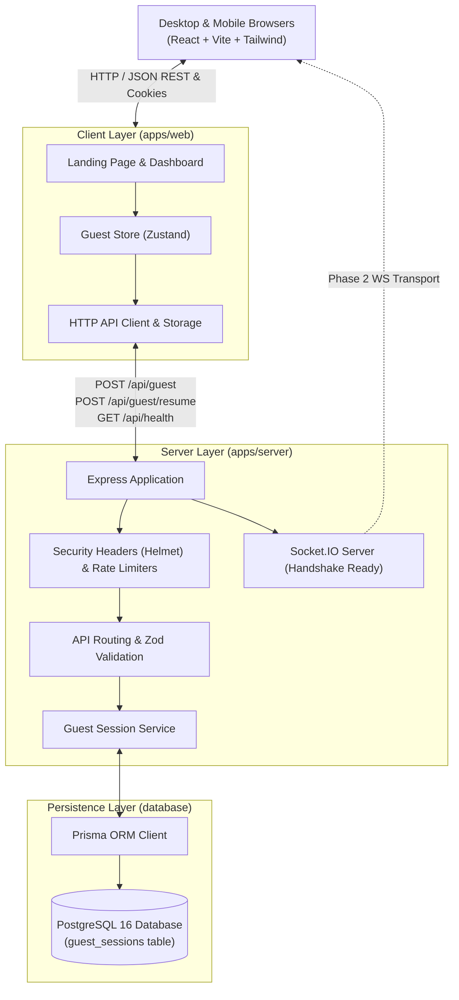
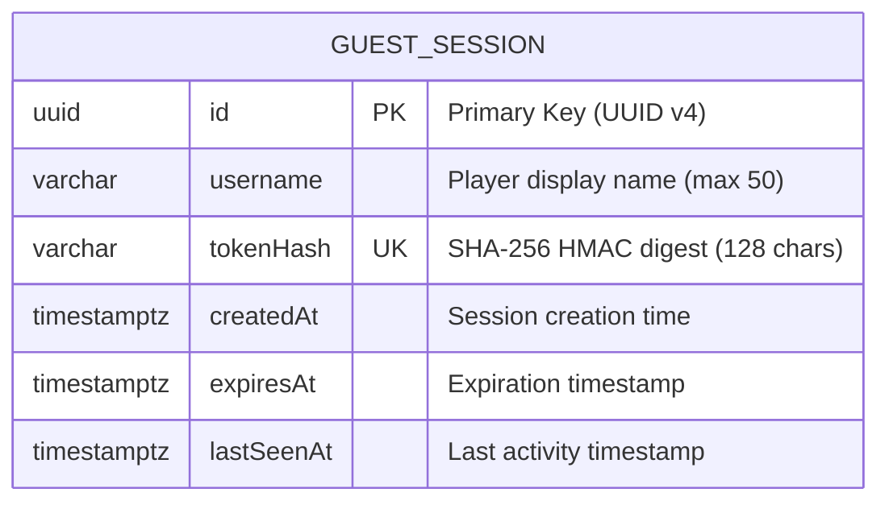
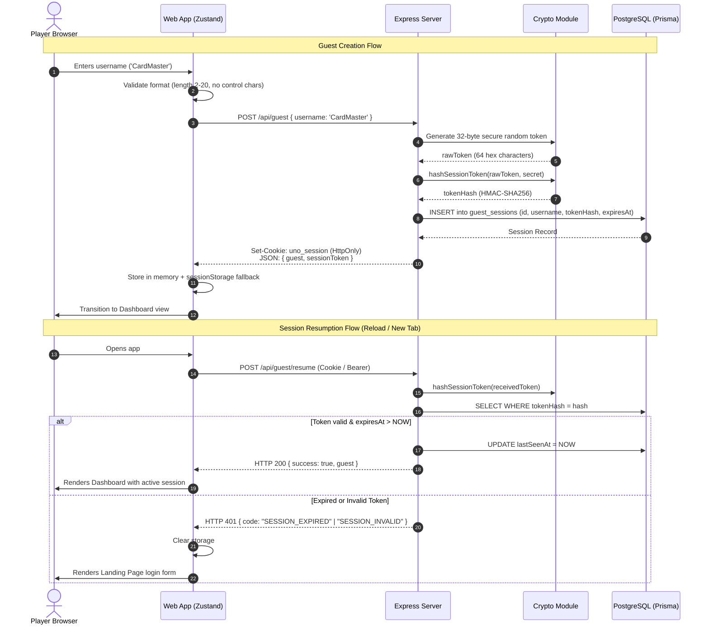
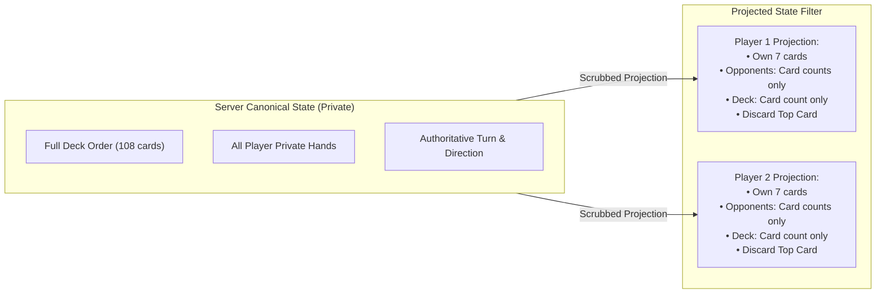

# UNO Ultimate — Phase 1: Architecture Specification

## 1. System Overview

UNO Ultimate is an online, private multiplayer card game crafted specifically for groups of friends. It does not provide public matchmaking, open player lobbies, or social networking features.

Phase 1 establishes the foundational infrastructure, guest identity system, database layer, server-authoritative protocol contracts, and responsive frontend interface.



---

## 2. Frontend / Backend Communication

Communication in Phase 1 relies on typed REST endpoints backed by strict Zod schema validation:

1. **`GET /api/health`**
   - Returns operational status, server uptime, version, and PostgreSQL connectivity with database latency.
2. **`POST /api/guest`**
   - Accepts `{ "username": string }`
   - Returns `{ "success": true, "data": { "guest": GuestSessionPublic, "sessionToken": string } }`
   - Issues an `HttpOnly`, `SameSite=Lax/Strict`, `Secure` (production) cookie named `uno_session`.
3. **`POST /api/guest/resume`**
   - Accepts optional `{ "sessionToken": string, "guestId": string }`
   - Reads session token from cookie, `Authorization: Bearer <token>`, or request body.
   - Refreshes session `lastSeenAt` and renews the cookie lifespan.

---

## 3. Database Design

The persistence layer is managed by Prisma ORM backed by PostgreSQL 16.



### Table Definition
```sql
CREATE TABLE "guest_sessions" (
    "id" UUID NOT NULL DEFAULT gen_random_uuid(),
    "username" VARCHAR(50) NOT NULL,
    "tokenHash" VARCHAR(128) NOT NULL,
    "createdAt" TIMESTAMPTZ(6) NOT NULL DEFAULT CURRENT_TIMESTAMP,
    "expiresAt" TIMESTAMPTZ(6) NOT NULL,
    "lastSeenAt" TIMESTAMPTZ(6) NOT NULL DEFAULT CURRENT_TIMESTAMP,

    CONSTRAINT "guest_sessions_pkey" PRIMARY KEY ("id")
);

CREATE UNIQUE INDEX "guest_sessions_tokenHash_key" ON "guest_sessions"("tokenHash");
CREATE INDEX "idx_guest_sessions_token_hash" ON "guest_sessions"("tokenHash");
CREATE INDEX "idx_guest_sessions_expires_at" ON "guest_sessions"("expiresAt");
```

---

## 4. Guest Session Lifecycle



---

## 5. Security Model

1. **High-Entropy Tokens**: Session tokens are generated using Node.js `crypto.randomBytes(32)` providing 256 bits of cryptographic entropy.
2. **One-Way Token Storage**: The raw token is **never** saved in the database. Only a SHA-256 HMAC digest computed with a server secret (`SESSION_SECRET`) is stored.
3. **Impersonation Prevention**: The server never trusts client-supplied guest IDs. On session resumption, the guest's identity is derived strictly from the verified session token hash. If a client attempts to pass a guest ID that differs from the token's authenticated owner, the request is rejected with `SESSION_IMPERSONATION` (HTTP 401).
4. **Timing-Safe Comparison**: Hashes are verified using `crypto.timingSafeEqual` to thwart timing side-channel attacks.
5. **Cookie Security**: Cookies are flagged `HttpOnly`, `SameSite=Lax` (or `Strict` in production), and `Secure` in production environments to mitigate XSS-based theft.
6. **Transport Fallback**: For cross-origin dev sandboxes or non-cookie clients, a Bearer token fallback is supported in `sessionStorage` (strictly avoiding long-lived `localStorage`).
7. **Rate Limiting**: `express-rate-limit` throttles brute-force attempts on `/api/guest` and `/api/guest/resume`.

---

## 6. Server-Authoritative Gameplay Architecture (Phases 2 & 3 Roadmap)

UNO Ultimate enforces strict server-authoritative integrity:



- **Zero Client Trust**: The client only renders projections and sends proposed actions (e.g. `play_card`, `draw_card`).
- **Deck Order Secrecy**: The deck order and opponent hands are completely stripped from network payloads. Clients cannot inspect browser memory to see upcoming cards.
- **Rules Authority**: The server rules engine validates move legality against official Mattel rules before committing state transitions.
