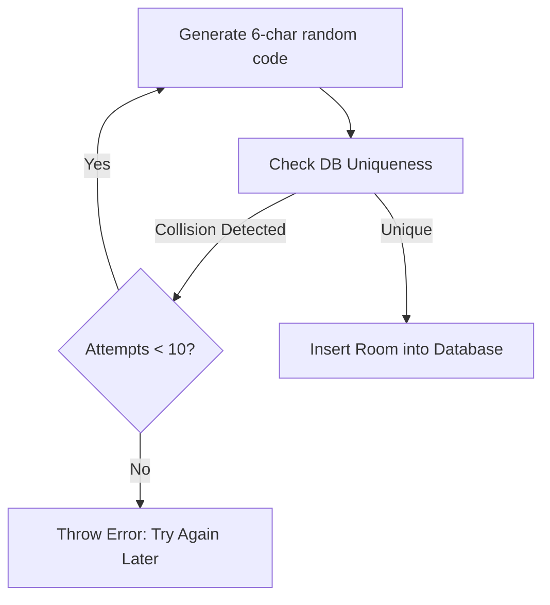
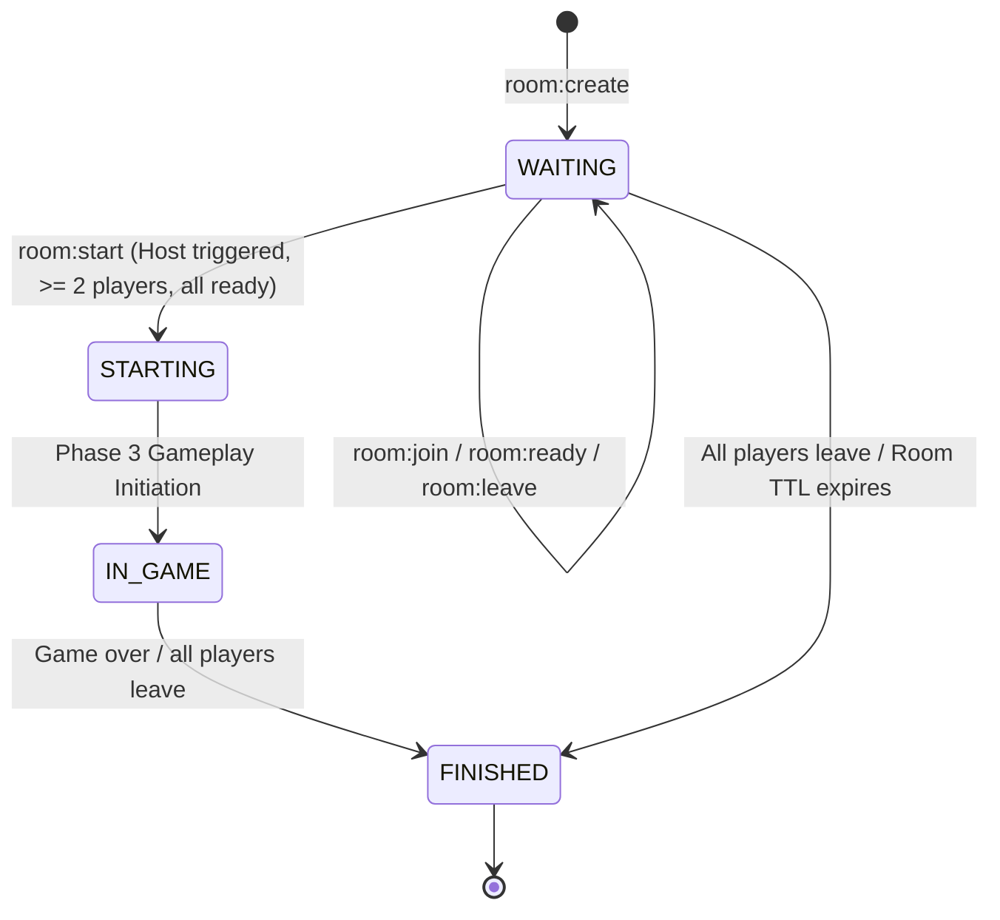
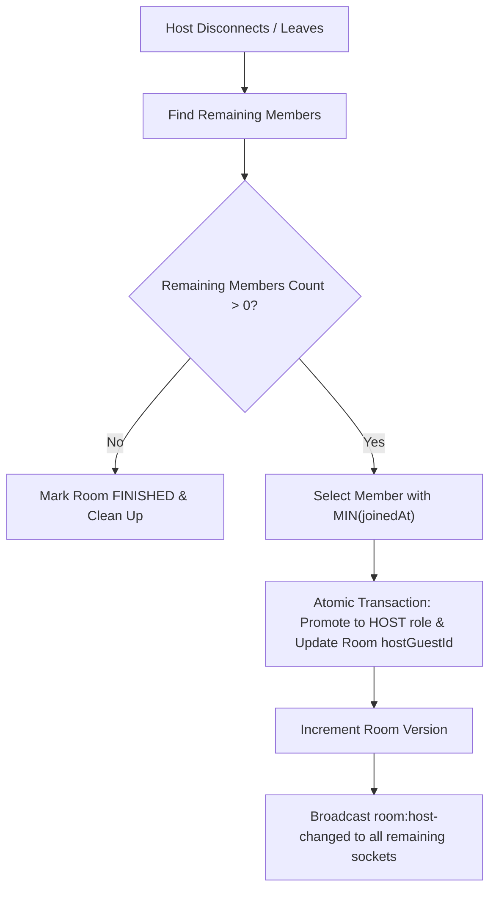
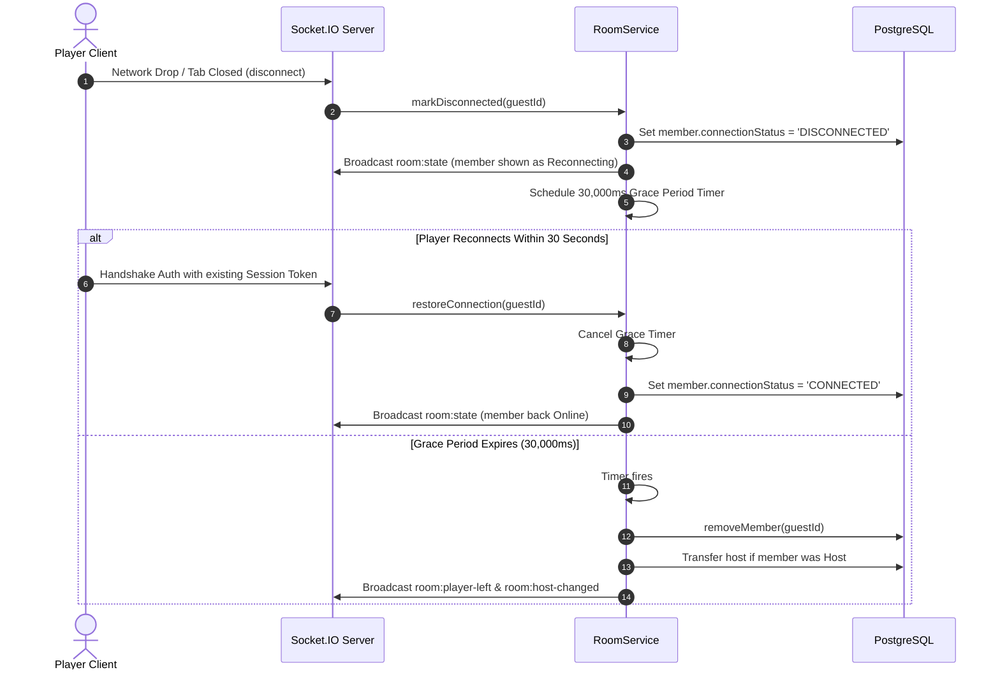

# UNO Ultimate — Phase 2: Private Rooms & Real-Time Presence Architecture

## 1. Executive Summary & Design Principles

UNO Ultimate Phase 2 introduces a server-authoritative private room and real-time lobby presence subsystem built on top of the Phase 1 guest identity foundation.

### Core Architectural Tenets
1. **Private Rooms Only**: No public room lists, no matchmaking, no passwords, and no host approval. Rooms are accessible solely through server-generated 6-character room codes or direct invitation links (`/join/:roomCode`).
2. **Server-Authoritative State**: Clients never dictate room state, member lists, or host privileges. Every mutation is validated by Zod schemas, authenticated against database-backed guest sessions, and transacted atomically in PostgreSQL via Prisma.
3. **No Unauthenticated or Client-Claimed Actions**: Every socket event and REST endpoint derives identity strictly from the cryptographically validated guest session token (via HttpOnly cookie or handshake authentication). Client-supplied IDs are never trusted.
4. **Resilient Disconnection & Presence Management**: 30-second reconnection grace period ensures intermittent network loss does not prematurely kick players or abort games.
5. **Deterministic Host Succession**: When a room host departs, host ownership is transferred deterministically to the earliest remaining member (`joinedAt ASC`), preventing room abandonment or host hijacking.

---

## 2. Database Schema & Data Integrity

The relational data model expands upon the Phase 1 `GuestSession` table with `Room` and `RoomMember` entities.

### Schema Definition
```prisma
enum RoomStatus {
  WAITING
  STARTING
  IN_GAME
  FINISHED
}

enum RoomMemberRole {
  HOST
  PLAYER
}

enum ConnectionStatus {
  CONNECTED
  DISCONNECTED
}

model Room {
  id          String       @id @default(uuid())
  roomCode    String       @unique
  hostGuestId String
  status      RoomStatus   @default(WAITING)
  maxPlayers  Int          @default(6)
  settings    Json         @default("{}")
  version     Int          @default(1)
  createdAt   DateTime     @default(now())
  updatedAt   DateTime     @updatedAt
  expiresAt   DateTime

  // Relations
  host        GuestSession @relation(fields: [hostGuestId], references: [id], onDelete: Cascade)
  members     RoomMember[]

  @@index([roomCode])
  @@index([status])
  @@index([expiresAt])
}

model RoomMember {
  id               String           @id @default(uuid())
  roomId           String
  guestId          String
  role             RoomMemberRole   @default(PLAYER)
  readyStatus      Boolean          @default(false)
  connectionStatus ConnectionStatus @default(CONNECTED)
  joinedAt         DateTime         @default(now())
  lastSeenAt       DateTime         @default(now())

  // Relations
  room             Room             @relation(fields: [roomId], references: [id], onDelete: Cascade)
  guest            GuestSession     @relation(fields: [guestId], references: [id], onDelete: Cascade)

  @@unique([roomId, guestId])
  @@index([roomId])
  @@index([guestId])
}
```

### Key Relational Safeguards
- `@@unique([roomId, guestId])`: Eliminates duplicate memberships for the same guest in a single room at the database engine level.
- `onDelete: Cascade`: If a guest session expires and is purged, all associated room memberships and hosted rooms are automatically cleaned up without leaving orphaned records.
- `version Int @default(1)`: Incremented atomically on every room mutation, providing an optimistic concurrency control mechanism and preventing stale lobby state overwrites on clients.

---

## 3. Cryptographically Secure Room Code Generation

Room codes are the sole gateway to private matches. To prevent transcription errors while maximizing entropy:

### Code Characteristics
- **Length**: 6 characters.
- **Alphabet**: `23456789ABCDEFGHJKLMNPQRSTUVWXYZ` (32 characters).
- **Ambiguity Exclusion**: Omitted visually ambiguous characters: `0` (zero), `O` (capital O), `1` (one), `I` (capital I), and `L` (lowercase L lookalike).
- **Entropy**: $32^6 = 1,073,741,824$ unique combinations (~1.07 billion).
- **Randomness Source**: Node.js `crypto.randomBytes()`.

### Collision Handling Strategy


Database transactions guarantee that even during theoretical simultaneous concurrent insertions of an identical code, the PostgreSQL unique index triggers a rollback and safe retry.

---

## 4. Room Lifecycle State Machine



### Lifecycle Rules:
1. **WAITING**: Room is open for players to join, toggle readiness, and adjust player capacity (host only). Room remains joinable if `playerCount < maxPlayers`.
2. **STARTING**: Host initiated the start sequence. Displays 5-second countdown. Join attempts are rejected.
3. **IN_GAME**: Card gameplay active (Phase 3). Mid-game joining is rejected. Reconnection for existing members remains permitted.
4. **FINISHED**: Room marked complete upon game conclusion or when all members depart. Scheduled for database purging.

---

## 5. Deterministic Host Transfer Algorithm

If the host leaves voluntarily (`room:leave`) or fails to reconnect before the 30-second grace period expires:



### Determinism Guarantee
Because `joinedAt` is an immutable timestamp assigned by PostgreSQL at membership creation, sorting by `joinedAt ASC` guarantees an unambiguous, deterministic choice of successor regardless of node clock skew or socket arrival ordering.

---

## 6. Disconnection & Reconnection Architecture (30s Grace Period)

UNO Ultimate implements a forgiving disconnection protocol designed for unstable mobile networks and browser tab reloads.



---

## 7. Concurrency & Race Condition Safeguards

1. **Prisma Transactions (`prisma.$transaction`)**:
   - Room creation (room insert + host member insert) is atomic.
   - Member joining (capacity check + membership insert) executes inside an isolated transaction.
   - Host transfer (promoting new host + updating room host ID + demoting/removing previous host) executes atomically.
2. **Optimistic Versioning (`room.version`)**:
   - Every mutation increments `room.version`.
   - The frontend Zustand store checks `incomingVersion >= currentVersion` before applying updates, guaranteeing stale out-of-order socket packets do not revert local state.
3. **Single Connection Per Guest Policy**:
   - The server maintains a guest-to-socket map. If a player connects from a second browser tab, the older socket receives a `SESSION_REPLACED` notification and is forcefully disconnected, preventing ghost connections.

---

## 8. Multi-Instance Redis Scaling Roadmap

In Phase 2, Socket.IO and the timer map run in-process on a single Node.js instance (fully satisfying requirements for private games among friends).

### Future Multi-Instance Architecture (Phase 3+)
To scale horizontally across multiple container instances:
1. **Socket.IO Redis Adapter**:
   - Replace in-memory Socket.IO emitter with `@socket.io/redis-adapter` for pub/sub cross-node broadcasting.
2. **Distributed Reconnection Timers**:
   - Store disconnection timers in Redis keys with TTL and keyspace notifications (`notify-keyspace-events Ex`), or use BullMQ delayed jobs.
3. **Database Locks**:
   - Utilize PostgreSQL row-level locking (`SELECT ... FOR UPDATE`) or Redis Redlock for strict join concurrency across distributed servers.
