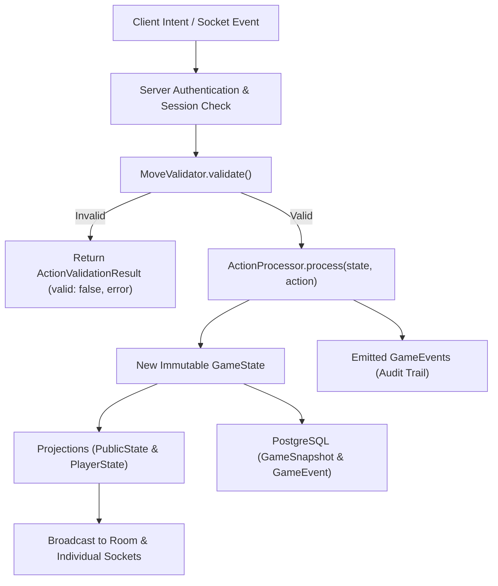
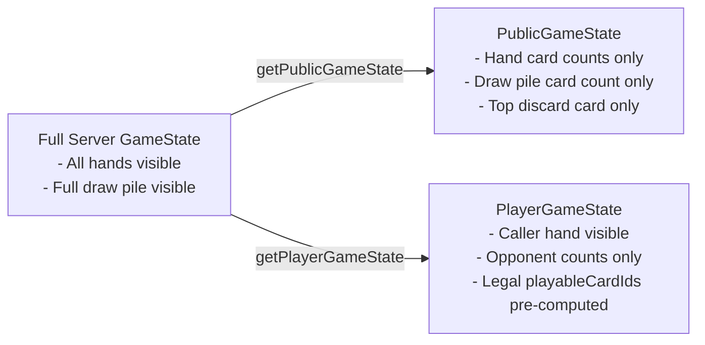

# UNO Ultimate — Phase 3: Server-Authoritative Game Engine Architecture

## 1. Executive Summary & Design Principles

UNO Ultimate Phase 3 introduces an independent, deterministic, server-authoritative game engine package (`@uno-ultimate/game-engine`) that encapsulates all rules, deck management, turn rotation, move validation, action card resolution, and state projections for the classic card game UNO.

```
┌─────────────────────────────────────────────────────────────┐
│                    UNO Ultimate Ecosystem                    │
├─────────────────────────┬───────────────────────────────────┤
│  Frontend (apps/web)    │  Backend (apps/server)            │
│  - React, Tailwind CSS  │  - Express, Socket.IO             │
│  - Zustand, Router      │  - Guest & Room Services          │
│  - Future Gameplay UI   │  - Match Persistence & Orchestr.  │
├─────────────────────────┴───────────────────────────────────┤
│           Shared Transport Protocol (@uno-ultimate/game-protocol) │
├─────────────────────────────────────────────────────────────┤
│         Core Game Engine (@uno-ultimate/game-engine)        │
│  - 100% Transport-Agnostic, UI-Agnostic, Zero IO            │
│  - Pure State Transitions: (State, Action) -> State + Events│
│  - Cryptographic & Deterministic Seeded Shuffling           │
│  - Authoritative Move Validation & Mattel Classic Rules     │
│  - Secure State Projections (Concealed Hands & Decks)       │
└─────────────────────────────────────────────────────────────┘
```

### Core Architectural Principles
1. **Strict Transport & UI Agnosticism**: The engine has zero dependencies on React, Express, Socket.IO, browser DOM APIs, or filesystem operations. It is a pure TypeScript library.
2. **Server Authoritative & Pure State Transitions**: Clients never mutate state directly. All game progress occurs via `ActionProcessor.process(state, action)`, returning a brand new immutable `GameState` alongside emitted `GameEventRecord` instances.
3. **Information Hiding by Design**: Hidden information (opponents' card identities and draw pile order) is never sent to clients. The engine projects `PublicGameState` and player-specific `PlayerGameState` before serialization.
4. **Deterministic & Cryptographic RNG**: In production, deck shuffling uses Node.js `crypto.randomBytes()`. For automated testing, replay verification, and simulations, seeded pseudo-random generators (such as Mulberry32) guarantee 100% reproducible card deals and turns.
5. **Exact Mattel Classic UNO Fidelity**: No unverified house rules (such as Draw Two / Wild Draw Four stacking, jump-ins, or 7-0 swaps). The engine strictly respects the official 108-card deck and ruleset.
6. **Extensible Variant Architecture**: Core card matching, turn flow, and deck generators are structured through the `UnoVariant` interface, enabling future official Mattel editions (UNO Flip, UNO Attack, UNO All Wild) without refactoring the core state machine.

---

## 2. Package Architecture (`packages/game-engine/`)

The package is partitioned into focused, single-responsibility domains:

```
packages/game-engine/
├── src/
│   ├── cards/
│   │   ├── card.types.ts       # Card colors, values, types, and interfaces
│   │   ├── card.factory.ts     # Immutable card factory functions and scoring
│   │   └── card.validation.ts  # Zod validation schemas and type guards
│   ├── deck/
│   │   ├── deck.factory.ts     # Official 108-card deck generator
│   │   ├── deck.shuffle.ts     # Fisher-Yates cryptographic & deterministic shuffle
│   │   └── deck.manager.ts     # Draw pile, discard pile, reshuffle, conservation
│   ├── players/
│   │   ├── player.types.ts     # Player and hand interfaces
│   │   └── hand.manager.ts     # Hand dealing, card insertion/removal, score calc
│   ├── turns/
│   │   ├── turn.direction.ts   # CLOCKWISE / COUNTER_CLOCKWISE & toggle
│   │   └── turn.manager.ts     # Turn sequencing and 2-player special rules
│   ├── validation/
│   │   └── move.validator.ts   # Mattel move validation (color, value, wild)
│   ├── actions/
│   │   ├── action.types.ts     # Action and event discriminated unions
│   │   └── action.processor.ts # Pure state transition processor
│   ├── game/
│   │   ├── game.types.ts       # Full GameState, winner, and config interfaces
│   │   ├── game.factory.ts     # Game setup, hand dealing, and starting discard flip
│   │   ├── game.state.ts       # GameEngine class wrapper
│   │   └── game.serializer.ts  # JSON serialization and deserialization
│   ├── projections/
│   │   ├── public-state.ts     # Sanitized state projection for observers/general sync
│   │   └── player-state.ts     # Player-specific projection with playableCardIds
│   ├── variants/
│   │   ├── variant.types.ts    # Variant specification interface and registry
│   │   └── classic/            # Mattel Classic UNO 108-card implementation
│   │       ├── classic.definition.ts
│   │       └── classic.rules.ts
│   ├── testing/
│   │   └── deterministic-random.ts # Seeded PRNGs (Mulberry32, sequence RNG)
│   └── index.ts                # Public API barrel export
```

---

## 3. Pure Immutable State Machine

The core engine follows a strict unidirectional state transition model:

$$\text{ActionProcessor.process}: (\text{GameState}, \text{GameAction}) \longrightarrow \text{GameState}$$



### Action Types & Handlers
Every mutation in the game corresponds to a strongly typed `GameAction`:
- `START_GAME`: Deals 7 cards per player, establishes discard pile, resolves start card effect.
- `PLAY_CARD`: Validates card legality, moves card to discard pile, applies action card effects, checks UNO shout requirement, and checks for round victory.
- `DRAW_CARD`: Draws top card from draw pile (reshuffling discard if draw pile is depleted). If drawn card is playable, marks it as drawn-and-playable.
- `PASS_TURN`: Voluntarily passes after drawing a card.
- `CHOOSE_COLOR`: Sets the active color when a Wild or Wild Draw Four card was played.
- `CALL_UNO`: Registers a player's official UNO shout.
- `CHALLENGE_UNO_FAILURE`: Allows any player to challenge a player with 1 card who failed to shout UNO before the next turn, imposing a 2-card draw penalty.

---

## 4. Deck Management & Card Conservation

### 108-Card Mattel Deck Composition
The classic UNO deck consists of exactly 108 cards across 4 primary colors (`red`, `yellow`, `green`, `blue`) and neutral wilds:

| Card Classification | Breakdown | Total Cards |
| :--- | :--- | :--- |
| **Number 0 Cards** | 1 per color ($1 \times 4$) | 4 |
| **Number 1–9 Cards** | 2 per number per color ($2 \times 9 \times 4$) | 72 |
| **Action: Skip** | 2 per color ($2 \times 4$) | 8 |
| **Action: Reverse** | 2 per color ($2 \times 4$) | 8 |
| **Action: Draw Two (+2)** | 2 per color ($2 \times 4$) | 8 |
| **Wild** | Neutral, 4 cards | 4 |
| **Wild Draw Four (+4)** | Neutral, 4 cards | 4 |
| **Total Canonical Deck** | | **108 Cards** |

### Deck Conservation Law
At every step in the game lifecycle, the total card count across all storage locations must remain strictly invariant:

$$|\text{DrawPile}| + |\text{DiscardPile}| + \sum_{p \in \text{Players}} |\text{Hand}_p| \equiv 108$$

The `DeckManager.assertDeckConservation` function verifies this invariant in test and debug builds.

### Depletion & Reshuffle Mechanics
When cards are requested from the draw pile and $|\text{DrawPile}| < N$:
1. If $|\text{DiscardPile}| \le 1$, only the remaining cards in the draw pile can be drawn; no reshuffle occurs.
2. If $|\text{DiscardPile}| > 1$, the top card of the discard pile is preserved in place as the active discard.
3. All underlying discard pile cards ($|\text{DiscardPile}| - 1$) are collected, their wild selected colors are reset to `undefined`, and they are shuffled using the active RNG to form a fresh draw pile.
4. The requested cards are then drawn from this newly replenished draw pile.

---

## 5. Turn Sequencing & 2-Player Mattel Rules

### Standard Turn Resolution
- Turn progression is governed by `turnDirection` (`CLOCKWISE` or `COUNTER_CLOCKWISE`).
- Moving to the next player uses modular arithmetic:
  $$\text{NextIndex} = (i \pm \text{skipCount}) \pmod N$$
  where $N$ is the number of players.

### Official 2-Player Edge Cases
Mattel's official rules specify unique mechanics for 2-player matches ($N = 2$):
1. **Reverse as Skip**: In a 2-player game, playing a **Reverse** acts identically to a **Skip**—it skips the opponent and returns the turn immediately to the player who played it.
2. **Skip**: Skips the opponent; the player plays again.
3. **Draw Two**: The opponent draws 2 cards and loses their turn; the player plays again.
4. **Wild Draw Four**: The opponent draws 4 cards and loses their turn; the player plays again.

These rules are fully encoded in `TurnManager.resolveNextTurn` and tested for both 2-player and multi-player configurations.

---

## 6. Information Hiding & State Projections

To prevent cheating and client-side inspection via browser DevTools or WebSocket snooping, the server never transmits raw `GameState` to clients.



### 1. `PublicGameState`
- Hand contents are replaced by `cardCount: number`.
- The draw pile is replaced by `drawPileCount: number`.
- Only the top card of the discard pile (`topCard`) and active color (`activeColor`) are revealed.

### 2. `PlayerGameState`
- Extends public state with the calling player's specific hand (`hand: Card[]`).
- Calculates `playableCardIds: string[]` on the server using `MoveValidator.getLegalMoves()`, allowing the frontend to highlight playable cards without duplicating validation logic or exposing unauthorized moves.

---

## 7. Variant Architecture & Extensibility

The engine decouples variant-specific rules from the core execution harness through the `UnoVariant` contract:

```typescript
export interface UnoVariant {
  readonly id: string;
  readonly name: string;
  readonly description: string;
  readonly minPlayers: number;
  readonly maxPlayers: number;
  readonly targetScore: number;
  createDeck(rng?: () => number): Card[];
  isMoveLegal(card: Card, topDiscard: Card, activeColor: CardColor): boolean;
  scoreHand(cards: readonly Card[]): number;
}
```

The `VariantRegistry` provides thread-safe registration and retrieval of variants. Phase 3 provides the canonical `classic` variant:
- Registry ID: `'classic'`
- Target score: 500 points
- Official 108-card deck generator
- Standard Mattel matching and scoring rules

---

## 8. Database Persistence Architecture

To support match tracking, statistics, game resumption, and historical audit logs, the PostgreSQL schema is extended with four dedicated relational entities:

```prisma
enum MatchStatus {
  IN_PROGRESS
  COMPLETED
  ABANDONED
}

model Match {
  id             String         @id @default(uuid())
  roomId         String
  status         MatchStatus    @default(IN_PROGRESS)
  variant        String         @default("classic")
  winnerGuestId  String?
  startedAt      DateTime       @default(now())
  finishedAt     DateTime?
  currentRound   Int            @default(1)
  targetScore    Int            @default(500)
  createdAt      DateTime       @default(now())
  updatedAt      DateTime       @updatedAt

  room           Room           @relation(fields: [roomId], references: [id], onDelete: Cascade)
  winner         GuestSession?  @relation(fields: [winnerGuestId], references: [id], onDelete: SetNull)
  players        MatchPlayer[]
  events         GameEvent[]
  snapshots      GameSnapshot[]

  @@index([roomId])
  @@index([status])
}

model MatchPlayer {
  id             String         @id @default(uuid())
  matchId        String
  guestId        String
  seatIndex      Int
  score          Int            @default(0)
  cardsRemaining Int            @default(7)
  isWinner       Boolean        @default(false)
  joinedAt       DateTime       @default(now())

  match          Match          @relation(fields: [matchId], references: [id], onDelete: Cascade)
  guest          GuestSession   @relation(fields: [guestId], references: [id], onDelete: Cascade)

  @@unique([matchId, guestId])
  @@unique([matchId, seatIndex])
  @@index([matchId])
}

model GameEvent {
  id             String         @id @default(uuid())
  matchId        String
  sequenceNumber Int
  eventType      String
  payload        Json
  createdAt      DateTime       @default(now())

  match          Match          @relation(fields: [matchId], references: [id], onDelete: Cascade)

  @@unique([matchId, sequenceNumber])
  @@index([matchId])
}

model GameSnapshot {
  id             String         @id @default(uuid())
  matchId        String
  sequenceNumber Int
  state          Json
  createdAt      DateTime       @default(now())

  match          Match          @relation(fields: [matchId], references: [id], onDelete: Cascade)

  @@unique([matchId, sequenceNumber])
  @@index([matchId])
}
```

### Design Advantages
- **Event Sourcing & Auditing**: Every `GameAction` processed produces a sequential `GameEvent` row with a guaranteed unique `sequenceNumber`.
- **Fast Resumption**: Periodic `GameSnapshot` records store the serialized `GameState`, enabling fast state restoration without replaying hundreds of events from scratch.
- **Relational Integrity**: Deletion or expiration of parent rooms cascades safely to matches, players, events, and snapshots.
