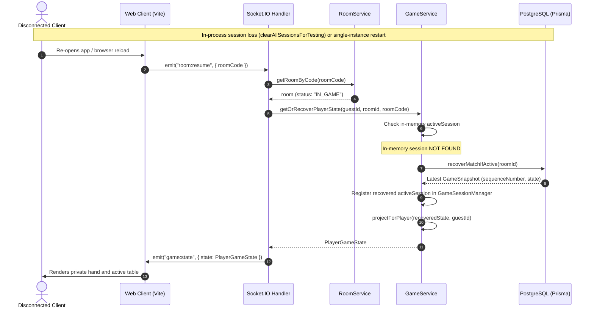

# UNO Ultimate — Phase 4.1: Rules, Event Integrity & Recovery Architecture

## 1. Executive Summary & Audit Scope

Phase 4.1 conducts a targeted correctness and reliability audit of the UNO Ultimate multiplayer platform following the completion of Phase 4.
The core objective of this phase is to harden game-engine mechanics against official Mattel 42001 rules, enforce strictly monotonic and unbroken game event sequencing, ensure ACID transactional persistence, verify cold-start server crash recovery, and establish automated browser end-to-end testing with multi-context Playwright suites.

---

## 2. Opening Reverse Mechanics (Correction A)

### 2.1 The Mattel 42001 Specification
Under official Mattel 42001 instructions (Action Cards / Reverse):
> *"Reverse — If this card is turned up at the start of play, the player to the dealer's right plays first, and play proceeds to the right instead of the left."*

In circular seating with dealer index $D$ and $N$ players, moving counter-clockwise (to the right of the dealer) designates the first active player index as:

$$\text{FirstPlayer} = (D - 1 + N) \pmod N$$

### 2.2 Concrete Seating Calculations
- **4 Players ($N=4, D=0$)**: Player to dealer's right is $(0 - 1 + 4) \pmod 4 = 3$. Play proceeds counter-clockwise: $3 \to 2 \to 1 \to 0$.
- **3 Players ($N=3, D=0$)**: Player to dealer's right is $(0 - 1 + 3) \pmod 3 = 2$. Play proceeds counter-clockwise: $2 \to 1 \to 0$.
- **2 Players ($N=2, D=0$)**: Player to dealer's right is $(0 - 1 + 2) \pmod 2 = 1$, which is the non-dealer opponent. Play continues alternating counter-clockwise.

### 2.3 Implementation Details
Implemented in `packages/game-engine/src/game/game.factory.ts`:
- **Round 1 (`createGame`)**:
  ```typescript
  if (topDiscardCard.value === 'reverse') {
    turnDirection = 'counter_clockwise';
    currentPlayerIndex = TurnManager.getNextPlayerIndex(dealerIndex, playerCount, 'counter_clockwise', 1);
  }
  ```
- **Subsequent Rounds (`startNextRound`)**:
  Applies the identical circular counter-clockwise offset relative to `newDealerIndex`.

---

## 3. Canonical Dealer Determination & Tie-Resolution Policy (Correction B)

### 3.1 Mattel 42001 Specification & Point Value System
Per official Mattel 42001 instructions (Setup and Scoring sections):
- The physical box contains 112 cards (including 4 customizable Blank Cards). For digital gameplay, UNO Ultimate implements the canonical 108 non-blank cards (76 number, 24 action, 8 wild cards), intentionally omitting the optional Blank Cards.
- Each player draws a card from the shuffled deck.
- The player with the highest point value deals.
- Point values are defined by the official 42001 Scoring table (not a separate tournament convention):
  - **Number cards (0–9)**: Face value (0 to 9 points).
  - **Action cards (Skip, Reverse, Draw Two)**: **20 points** each.
  - **Wild cards (Wild, Wild Draw Four)**: **50 points** each.
- The rule that action cards count 20 points and wild cards count 50 points derives directly from the 42001 instruction sheet; there is no rule stating symbol cards count as zero.

### 3.2 Application-Level Tie-Resolution Policy
The official Mattel 42001 instruction sheet states that the highest point value deals, but does not specify a procedure for automated tie resolution. To avoid unbounded loops or arbitrary silent selections, the engine implements a documented **application-level tie-resolution policy** (distinct from official Mattel text):
1. **Candidate Redraws**: Tied candidates redraw cards from the deck in sequential tie rounds.
2. **Bounded Retries**: A safety ceiling of `maxTieRounds = 20` prevents infinite loop scenarios under degenerate RNG fixtures.
3. **Deterministic Fallback**: If a tie persists after 20 rounds, the candidate with the lowest remaining seat index (`Math.min(...candidates)`) is deterministically chosen, flagging `resolvedByFallback: true`.
4. Fully exposed and inspected via `GameFactory.determineDealerDetailed()`. Note: selecting the highest point card is the official Mattel rule; the redraw loop, 20-round ceiling, and seat-index fallback are explicit application-level engineering choices.

---

## 4. Game Event Sequence Monotonicity & Invariant (Correction C)

### 4.1 Sequence Gap Problem
In Phase 4, multi-event actions (e.g. playing a card that triggers a draw and turn advance) incremented event sequence numbers locally while `nextState.sequenceNumber` remained incremented only once. Subsequent actions attempted to use duplicate or gapped sequence numbers, colliding with the database constraint:

```prisma
@@unique([matchId, sequenceNumber])
```

### 4.2 Sequence Invariant Formulation
To guarantee strictly monotonic, gapless, and collision-free event ordering, the engine enforces the following invariant across all actions:

$$\text{nextState.sequenceNumber} \equiv \begin{cases} \text{events.at}(-1)\text{.sequenceNumber}, & \text{if } |\text{events}| > 0 \\ \text{state.sequenceNumber}, & \text{otherwise} \end{cases}$$

### 4.3 Engine Processing Logic
Implemented in `packages/game-engine/src/actions/action.processor.ts`:
```typescript
let runningSeq = state.sequenceNumber;
for (const rawEvent of generatedEvents) {
  runningSeq++;
  finalEvents.push({
    ...rawEvent,
    sequenceNumber: runningSeq,
  });
}

return {
  nextState: {
    ...intermediateState,
    sequenceNumber: runningSeq,
  },
  events: finalEvents,
};
```
Every single action emitted by the engine advances `sequenceNumber` to match the exact sequence number of the final generated event.

---

## 5. Atomic Transactional Persistence (Correction D)

### 5.1 Architecture: Single Prisma `$transaction`
To prevent torn state or database-to-memory desynchronization during network failures, crashes, or constraint errors, `apps/server/src/modules/game/game.persistence.service.ts` encapsulates all match mutations in a single atomic transaction:

```
┌────────────────────────────────────────────────────────┐
│               prisma.$transaction                      │
│                                                        │
│  1. Update Match record (status, round, score, winner) │
│  2. Update MatchPlayer records (score, cardCount)      │
│  3. Insert GameEvent records (events 1..N)             │
│  4. Upsert GameSnapshot record (serialized GameState)  │
└────────────────────────────────────────────────────────┘
```

### 5.2 Failure Invariant & Rollback Verification
- If any database operation fails within the transaction, Prisma performs an automatic rollback across all statements.
- In `game.service.ts`, `persistActionBatch` is awaited **prior** to updating in-memory session state:
  ```typescript
  await this.persistenceService.persistActionBatch(matchId, nextState, events);
  activeSession.state = nextState; // Advances ONLY after database commit succeeds
  ```
- If the persistence transaction fails, an exception is thrown, the in-memory state remains untouched, and no corrupt state is broadcast.
- **Rollback Test Verification**: Validated in `apps/server/tests/integration/game.socket.test.ts` by intercepting `tx.gameSnapshot.upsert` inside `prisma.$transaction` to throw an error after `tx.match.update`, `tx.matchPlayer.updateMany`, and `tx.gameEvent.create` execute. The test verifies that PostgreSQL performs a complete ACID rollback, leaving zero uncommitted records or sequence number gaps.

---

## 6. In-Process Session-Loss Rehydration & Recovery (Correction E)

### 6.1 Recovery Flow Diagram


### 6.2 Key Verification Gates & Architecture Boundary
- **Membership Verification**: Prevents unauthorized guests from snooping active matches.
- **Snapshot Integrity**: The latest `GameSnapshot` is deserialized with intact draw/discard piles, player hands, active color, and turn pointers.
- **Personalized Projection**: Only the recovering player's own 7 cards are decrypted and sent in `self.hand`; opponent hands remain obscured as counts.
- **Architecture Boundary & Test Reality**: In unit/integration tests, this recovery is validated by invoking `clearAllSessionsForTesting()` on `GameSessionManager` to simulate complete in-process memory loss without terminating the Node.js test process. This demonstrates durable snapshot reconstruction within a single-process server architecture. It does not test OS process respawning or multi-instance cluster synchronization (e.g. Redis pub/sub).

---

## 7. Production Countdown Bypass Protection & Cancellation (Correction G)

In `apps/server/src/sockets/roomSocketHandler.ts`:
- In development/production environments, a 5-second countdown notification (`room:starting`) is unconditionally enforced before the game engine initializes (`PRODUCTION_COUNTDOWN_MS = 5000`).
- Active timers are tracked in `activeCountdownTimers: Map<string, NodeJS.Timeout>`.
- If any player toggles ready to `false`, leaves the room, or disconnects during the 5-second countdown, `cancelCountdownIfActive()` immediately aborts the timer and broadcasts `room:starting` with `countdownSeconds: 0`.
- The countdown duration is configurable strictly in test environments via `setCountdownDurationForTesting()`, which throws in production environments.
- Any unauthorized payload sending `immediate: true` in non-test environments is rejected, maintaining the strict 5000ms countdown.

---

## 8. Test Tier Stratification (Correction F)

To maintain testing speed, deterministic repeatability, and multi-layer coverage, testing is stratified across complementary tiers:
1. **Unit Tier (`packages/game-engine/tests`)**: Pure deterministic rules, action effects, dealer ties, UNO penalties, and projections (79 tests across 7 suites).
2. **Integration Tier (`apps/server/tests/integration` and `apps/server/tests/unit`)**: Real HTTP/WebSocket networking, PostgreSQL transactions, sequence monotonicity, full round playouts down to 0 cards, dealer rotation, multi-round 500-point threshold, transaction rollbacks, and in-process state recovery (57 tests across 9 suites).
3. **Frontend Component Unit Tier (`apps/web/src/**/__tests__`)**: React components, stores, card rendering, and player actions (44 tests across 10 suites).
4. **Multi-Context Browser E2E Tier (`apps/web/tests/e2e`)**: High-fidelity browser testing in real Google Chrome (`channel: 'chrome'`) across two isolated contexts (`contextAlice` and `contextBob`), verifying lobby joining, countdown display, hand rendering, live turn interaction, and mid-match page reload recovery (2 end-to-end scenarios). Full-round completion down to zero cards and 500-point matches are validated deterministically in the integration tier (`apps/server/tests/integration/game.full-round.test.ts`).
