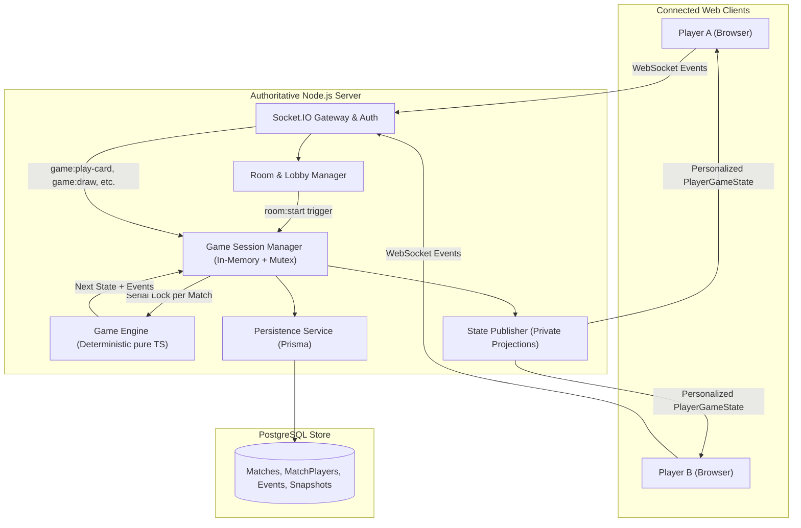
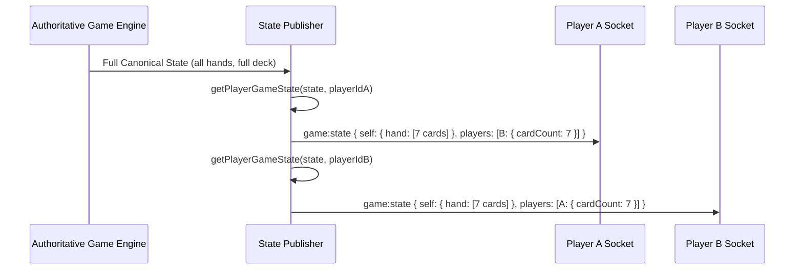
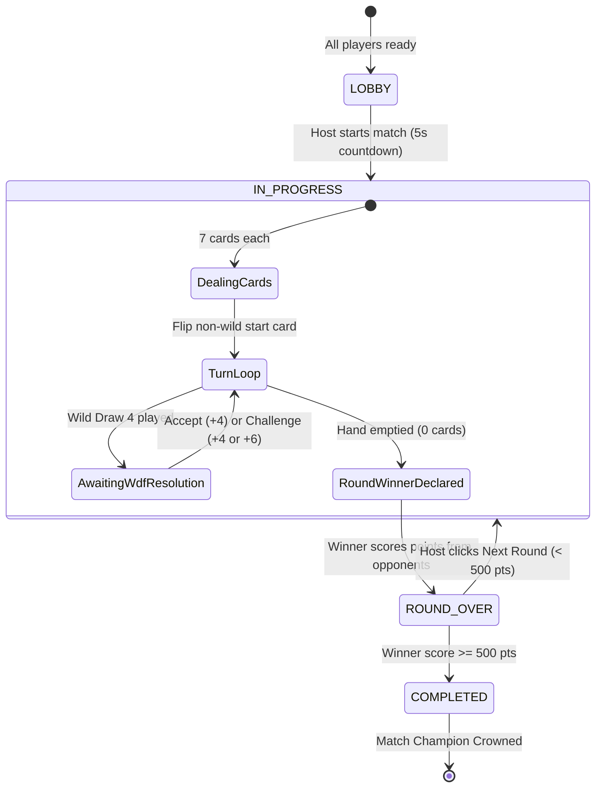

# UNO Ultimate — Phase 4 Gameplay Architecture

## 1. Overview & High-Level Architecture

Phase 4 introduces the real-time, server-authoritative multiplayer card gameplay engine for **Classic UNO** based strictly on Mattel product **42001** official rules.



---

## 2. Server-Authoritative Information Hiding & Security

### The Confidentiality Boundary
In UNO Ultimate, cheating via network packet inspection is strictly impossible by architectural design:
1. **Draw Pile Secrecy**: The full sequence and card identities of the draw pile exist only in server memory. Clients receive solely `drawPileCount: number`.
2. **Opponent Hand Confidentiality**: Opponents' hands are projected solely as `cardCount: number` and `hasDeclaredUno: boolean`. Cards in opponent hands are never serialized to third-party sockets.
3. **Challenger Hand Inspection Isolation**: During a Wild Draw Four challenge, the offender's held cards at the time of the challenge (`inspectedChallengedHand`) are projected **exclusively** to the victim making the challenge. All other participants and public room broadcasts receive `inspectedChallengedHand: null`.

### Projection Pipeline


---

## 3. Concurrency Locking & Race Condition Prevention

Network latency, simultaneous clicks, or concurrent socket events (e.g. two players attempting to challenge UNO or play cards at the exact same millisecond) must never corrupt game state or cause duplicate executions.

We implemented an asynchronous Promise queue mutex (`runWithLock`) within `GameSessionManager`:
```typescript
class GameSessionManager {
  private activeLocks: Map<string, Promise<unknown>> = new Map();

  public async runWithLock<T>(
    matchId: string,
    operation: (session: ActiveGameSession) => Promise<T>
  ): Promise<T> {
    const currentLock = this.activeLocks.get(matchId) || Promise.resolve();
    let releaseLock: () => void;
    const nextLock = new Promise<void>((resolve) => { releaseLock = resolve; });
    this.activeLocks.set(matchId, currentLock.then(() => nextLock));

    await currentLock;
    try {
      const session = this.activeSessions.get(matchId);
      return await operation(session);
    } finally {
      releaseLock!();
    }
  }
}
```
Every game action on a match executes sequentially under its own lock, guaranteeing atomic state transitions and deterministic sequence numbers.

---

## 4. Multi-Round Match Lifecycle (Mattel 42001)

Classic UNO is played over multiple rounds until a player accumulates 500 points:



1. **Dealer Rotation**: The dealer index advances clockwise by 1 for each round.
2. **Initial Play Direction**: Play always begins with the player to the left of the dealer.
3. **Start Card Validation**: If the card flipped from the draw pile to start the discard pile is a Wild or Wild Draw Four, it is returned to the draw pile and reshuffled until a non-Wild card is revealed.
4. **Final Action Card Execution**: If the winning card played is a Draw Two or Wild Draw Four, the target player must draw their cards before scores are calculated.
5. **Scoring Scheme**:
   - Number cards (0–9): Face value (0–9 points)
   - Action cards (Skip, Reverse, Draw Two): 20 points each
   - Wild & Wild Draw Four: 50 points each
6. **Round Over vs Completed**: If the round winner's total cumulative score across all rounds is `< 500`, the match enters `ROUND_OVER`. Either the host or participants can trigger `game:next-round`, dealing 7 fresh cards and rotating the dealer. Once a player reaches `500` points, the match transitions to `COMPLETED`.

---

## 5. Reconnection & Match Resumption

When a player disconnects or refreshes during an active match (`status === 'IN_GAME'`):
1. Their socket disconnects; the server retains their membership for the 30-second grace window.
2. Upon re-establishing the socket connection and authenticating with the valid guest session token, the client emits `room:resume` with `{ roomCode }`.
3. The server locates the active game session in `GameSessionManager` (or restores it from the latest PostgreSQL snapshot if the server restarted).
4. The server re-subscribes the socket to the room channel and immediately transmits the personalized `PlayerGameState`, preserving their hand, active color, turn indicators, and match points.

---

## 6. Persistence & Audit Pipeline

State mutations are backed up asynchronously via Prisma transactions:
- **`Match`**: Tracks `status`, `currentRound`, `targetScore`, `winnerGuestId`, and timestamps.
- **`MatchPlayer`**: Stores player seat indices, cumulative scores, and round rankings.
- **`GameEvent`**: Append-only log of every legal action (card played, card drawn, UNO shouted, challenge outcome) with strictly increasing sequence numbers.
- **`GameSnapshot`**: Full JSON snapshot of the internal engine state saved at key milestones (round finish, match finish, and periodically every 5 sequence ticks) for fault recovery.
