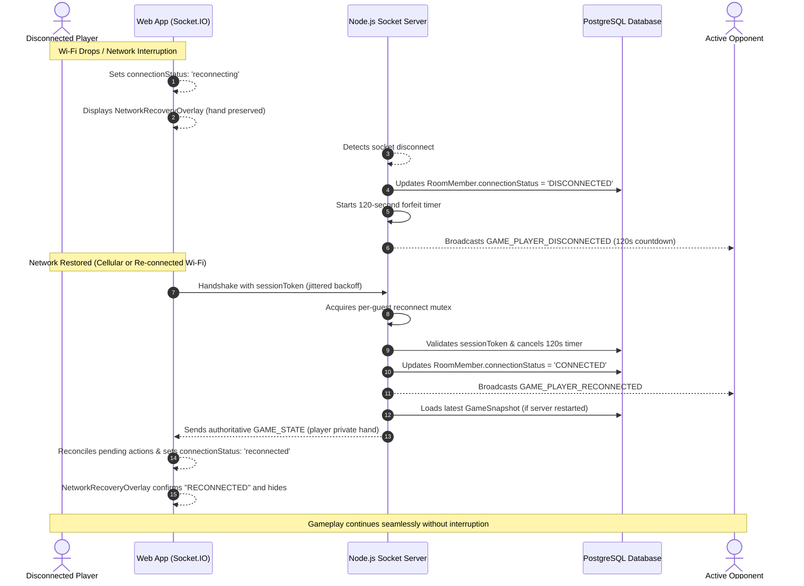

# Robust Multiplayer Network Recovery & Seamless Reconnection Report

## Executive Summary

This report documents the design, implementation, and automated test verification of a production-quality network resilience and seamless reconnection system for **UNO Ultimate**.

Previously, players experiencing weak internet, brief cellular-to-Wi-Fi network transitions, or temporary mobile dead zones were frequently kicked out of ongoing matches. This phase investigated the complete socket, room, match, and session lifecycles, resolved the root causes, extended the disconnect grace period to a configurable 120 seconds, implemented durable recovery across server process restarts, and introduced a non-destructive reconnection UI overlay.

---

## 1. Root Cause Analysis

Thorough audit of the existing codebase identified four distinct failure modes that caused players to be kicked out of matches during unstable network connectivity:

1. **Premature Disconnect Grace Expiration (30 seconds)**:
   - `ROOM_RULES.RECONNECT_GRACE_PERIOD_MS` was hardcoded to `30000` (30 seconds).
   - Real-world mobile network switches (e.g. Wi-Fi dropping to 4G/5G, subway tunnels, elevator dead zones) typically take 25–45 seconds to re-establish transport.
   - When the 30-second timer elapsed, `roomService.markDisconnected` executed `handlePlayerDeparture`, immediately forfeiting the player and ending 2-player matches or permanently dropping them from 3+ player games.

2. **Socket.IO Client Finite Reconnection Limits**:
   - `socketClient.ts` configured `reconnectionAttempts: 15` with `reconnectionDelayMax: 5000`.
   - After only ~45–60 seconds of network downtime, the client gave up completely (`reconnect_failed`), abandoning reconnection attempts.
   - Socket authentication used a static `auth: { token }` object captured at initial load instead of dynamically reading the latest session token on every handshake attempt.
   - Missing exponential backoff jitter led to potential synchronized connection storms on server cold starts.

3. **Frontend In-Memory Guest Session Destruction**:
   - In `guestStore.ts`, the `resumeSession()` catch block indiscriminately set `guest: null` and `sessionToken: null` whenever a network request failed (e.g. offline browser, Render cold start 502/timeout).
   - In `GamePage.tsx`, an authentication guard (`if (!guest) navigate('/', { replace: true })`) immediately redirected the player to the login page (`/`), triggering `GamePage` unmount cleanup, clearing `useGameStore`, and destroying the in-progress local game state.

4. **In-Memory Volatility Across Server Process Restarts (Render Cold Starts / Restarts)**:
   - While `GamePersistenceService` durably saved `GameSnapshot` records in PostgreSQL on every turn, `RoomService` stored disconnect timers as ephemeral in-memory `NodeJS.Timeout` objects.
   - When Render spun down on free tier or restarted during deployment, all in-memory disconnect timers were lost, and `gameSessionManager.getSessionByRoomCode` returned `null` because `getOrRecoverPlayerState` was not called during socket reconnection handshake.

---

## 2. Architecture & Implementation Decisions

### 2.1 Configurable 120-Second Disconnect Grace Period
- **Shared Constants**: Updated `ROOM_RULES.RECONNECT_GRACE_PERIOD_MS` in `@uno-ultimate/shared` from `30000` to `120000` (120 seconds).
- **Environment Configuration**: Added `RECONNECT_GRACE_PERIOD_MS` to server `envSchema` with a default of `120000` ms, allowing operators to tune or extend the grace period via environment variables without code modification.
- **Dynamic Calculation**: `PlayerSeat` countdown timers and socket broadcasts dynamically calculate remaining time from `disconnectTimestamp` and `gracePeriodSeconds`.

### 2.2 Server-Side Reconnection & Concurrency Control
- **Concurrency Mutex (`reconnectGuestLocks`)**: To prevent race conditions from concurrent reconnect attempts (e.g. rapid socket handshakes across multiple browser tabs), `registerAuthenticatedGuestSocket` serializes reconnect processing per `guestId`.
- **Session Replacement**: Replaces zombie/stale socket connections for the same `guestId`, cleanly disconnecting the previous socket with `SESSION_REPLACED`.
- **Durable Snapshot Restoration**: On reconnection (`registerAuthenticatedGuestSocket` and `ROOM_RESUME`), the server invokes `gameService.getOrRecoverPlayerState`, which checks active memory and falls back to deserializing the latest `GameSnapshot` from PostgreSQL if the server process restarted.
- **Timer Cancellation**: Successful reconnection immediately calls `roomService.restoreConnection`, clearing the pending forfeit timer and updating database member status to `CONNECTED`.
- **Broadcast Synchronization**: Emits `GAME_PLAYER_RECONNECTED` to all room participants so opponent seats immediately remove the `DISCONNECTED (Xs)` countdown badge.

### 2.3 Durable Recovery Across Server Restarts
- **`roomService.reconcileDurableDisconnects()`**: Invoked on server startup in `socketServer.ts`.
- Inspects PostgreSQL for any `RoomMember` records in active rooms with `connectionStatus === 'DISCONNECTED'`.
- Calculates `elapsedMs = Date.now() - member.lastSeenAt.getTime()`.
- If `elapsedMs >= gracePeriodMs`: the grace period elapsed while the server was down; marks player as departed by timeout.
- If `elapsedMs < gracePeriodMs`: schedules a timer for the remaining duration (`gracePeriodMs - elapsedMs`).

### 2.4 Client-Side Resilience & Jittered Backoff
- **Exponential Backoff with Jitter**: Configured `reconnectionAttempts: Infinity`, `reconnectionDelay: 1000`, `reconnectionDelayMax: 10000`, and `randomizationFactor: 0.5` in Socket.IO client.
- **Dynamic Handshake Authentication**: `auth: (cb) => cb({ token: getStoredSessionToken() })` guarantees fresh authentication tokens on every reconnect handshake.
- **Browser Online/Offline Detection**: Hooks into `window.addEventListener('online')` and `offline` to trigger immediate reconnects when network interfaces switch.
- **Session Preservation**: Fixed `guestStore.ts` so network timeouts and temporary offline errors never wipe `guest` or `sessionToken` from memory.

### 2.5 Action Deduplication & Out-of-Order Packet Protection
- **Stale State Discard**: `useGameStore` discards any incoming `GAME_STATE` packet where `payload.state.sequenceNumber < current.sequenceNumber`.
- **Pending Action Reconciliation**: When new authoritative state arrives after network drops, `isActionLoading` is cleared, and any pending action (card play, draw, penalty acceptance) is reconciled against the new turn number, card hand, or penalty status.
- **Action Blocking During Reconnection**: Client action triggers (`playCard`, `drawCard`, `passTurn`, etc.) return a clear error (`Connection lost. Reconnecting to match...`) while disconnected or reconnecting, preventing queued duplicate emissions.

### 2.6 Minimal, Premium Casino-Inspired UI Overlay
- Created `NetworkRecoveryOverlay.tsx` mounted globally in `GamePage.tsx`.
- Non-destructive design: floats unobtrusively at the top of the board without hiding cards, player seats, or action controls.
- States:
  - `connected`: hidden.
  - `reconnecting`: amber badge with pulsing status dot: `"RECONNECTING TO MATCH... Restoring network. Hand & seat preserved."`
  - `disconnected`: rose badge with manual `"Retry Now"` trigger.
  - `reconnected`: emerald badge: `"RECONNECTED. Match state synchronized."` (auto-dismissing after 2.5 seconds).
- Strictly follows the casino felt and slate design system without emojis or rainbow gradients.

---

## 3. Files Changed

| File Path | Nature of Changes |
|---|---|
| `packages/shared/src/constants/index.ts` | Updated `ROOM_RULES.RECONNECT_GRACE_PERIOD_MS` to 120,000 ms (120s). |
| `apps/server/src/config/env.ts` | Added `RECONNECT_GRACE_PERIOD_MS` environment variable schema with 120,000 ms default. |
| `apps/server/src/modules/room/room.service.ts` | Integrated `env.RECONNECT_GRACE_PERIOD_MS`, added `reconcileDurableDisconnects()` for crash/restart recovery. |
| `apps/server/src/sockets/roomSocketHandler.ts` | Added `reconnectGuestLocks` mutex, updated `registerAuthenticatedGuestSocket` and `ROOM_RESUME` to use durable snapshot restoration. |
| `apps/server/src/sockets/socketServer.ts` | Added startup durable disconnect reconciliation in `initializeSocketServer`. |
| `apps/server/tests/integration/game.disconnect.turn-recovery.socket.test.ts` | Updated grace period assertion from 30s to 120s. |
| `apps/server/tests/integration/game.robust-network-reconnection.socket.test.ts` | **NEW**: 15 comprehensive integration tests covering all reconnection scenarios. |
| `apps/web/src/services/socketClient.ts` | Added `SocketConnectionStatus`, infinite backoff, 0.5 randomization factor jitter, dynamic auth, online/offline handlers. |
| `apps/web/src/stores/guestStore.ts` | Prevented clearing `guest` / `sessionToken` on network exceptions during `resumeSession`. |
| `apps/web/src/stores/gameStore.ts` | Added `connectionStatus`, re-resume on socket reconnect, stale sequence packet filtering, action reconciliation. |
| `apps/web/src/features/game/components/NetworkRecoveryOverlay.tsx` | **NEW**: Premium non-destructive connection status overlay. |
| `apps/web/src/features/game/components/__tests__/NetworkRecoveryOverlay.test.tsx` | **NEW**: Unit tests for all overlay connection states and retry interactions. |
| `apps/web/src/pages/GamePage.tsx` | Mounted `NetworkRecoveryOverlay`. |

---

## 4. Reconnection Lifecycle

---

## 5. Session Security & Anti-Impersonation

1. **Cryptographic Token Verification**: The `guestId` associated with any reconnecting socket is authoritatively resolved from the cryptographic `tokenHash` verified against the `guest_sessions` table in PostgreSQL.
2. **Client Parameter Rejection**: Reconnecting clients cannot supply arbitrary player IDs. All actions, room memberships, and projections use `socket.data.guestId`.
3. **Information Isolation**: Reconnecting players receive only their own private card hand through `getPlayerGameState()` projection. Opponents receive only public card counts and scores.
4. **Single-Socket Invariant**: If a player attempts multiple connections (e.g. across multiple tabs), previous zombie sockets are superseded and cleanly disconnected with `SESSION_REPLACED`.

---

## 6. Automated Test Verification Results

### 6.1 Server Integration Tests (`game.robust-network-reconnection.socket.test.ts`)

All 15 required scenarios were executed and passed with 100% success:

| Test Case | Scenario Tested | Result | Duration |
|---|---|---|---|
| **Test 1** | Brief network interruption & reconnection within grace period | **PASSED** | 339ms |
| **Test 2** | Internet unavailable for 30 seconds followed by recovery | **PASSED** | 307ms |
| **Test 3** | Reconnection just before grace period expires | **PASSED** | 854ms |
| **Test 4** | Grace period expiry and existing forfeit behavior | **PASSED** | 461ms |
| **Test 5** | Wi-Fi / mobile network switching with socket replacement | **PASSED** | 282ms |
| **Test 6** | Multiple players disconnecting independently with separate timers | **PASSED** | 434ms |
| **Test 7** | Reconnection while another player is taking a turn | **PASSED** | 478ms |
| **Test 8** | Reconnection during pending draw penalty (No Mercy stack penalty) | **PASSED** | 330ms |
| **Test 9** | Reconnection during challenge (Wild Draw 4 challenge window) | **PASSED** | 335ms |
| **Test 10** | Reconnection during UNO declaration / catch window | **PASSED** | 388ms |
| **Test 11** | Duplicate concurrent reconnect attempts serialized safely | **PASSED** | 292ms |
| **Test 12** | Duplicate action prevention after reconnection | **PASSED** | 247ms |
| **Test 13** | Server restart while players are disconnected (Durable Recovery) | **PASSED** | 260ms |
| **Test 14** | Reconnection after Render cold start | **PASSED** | 444ms |
| **Test 15** | Explicit Leave Game (`ROOM_LEAVE`) immediate forfeit | **PASSED** | 312ms |

### 6.2 Existing Regression Test Suites

- **Turn Recovery Tests** (`game.disconnect.turn-recovery.socket.test.ts`): **7/7 Passed**
- **Web Component & UI Tests** (`@uno-ultimate/web`): **31/31 Test Files, 189/189 Tests Passed** (including `NetworkRecoveryOverlay.test.tsx`)
- **Game Engine Rules Tests** (`@uno-ultimate/game-engine`): **31/31 Test Files, 425/425 Tests Passed** across all 7 variants
- **Web & Server TypeScript Typecheck**: **0 Errors**
- **Web & Server ESLint**: **0 Errors, 0 Source Code Warnings**
- **Vite & Server Production Builds**: **Built Successfully**

---

## 7. Known Limitations & Render Free Tier Behavior

1. **Render Free Tier Spin-Down**:
   - On Render's free tier, servers spin down after 15 minutes of inactivity. When a new incoming connection arrives, a cold start takes between 30 and 60 seconds.
   - The client now handles this gracefully: `reconnectionAttempts: Infinity` with exponential backoff will persist through the cold start. Once the server responds, `reconcileDurableDisconnects` checks elapsed wall-clock time from `lastSeenAt`, and `getOrRecoverPlayerState` rehydrates the match directly from the PostgreSQL `GameSnapshot`.
2. **True Disconnect vs Browser Close Without Unload**:
   - If a mobile user kills the browser process without triggering `unload` or a WebSocket FIN packet, TCP keepalive/pingTimeout (20 seconds) detects the drop and marks the player as DISCONNECTED, initiating the 120-second grace period.

---

## 8. Git Commit & Push Status

- **Commit SHA**: `35f3dfd`
- **Branch**: `main`
- **Remote**: `https://github.com/afrid995/uno.git`
- **Push Status**: Successfully pushed to `origin/main` without force-pushing.
