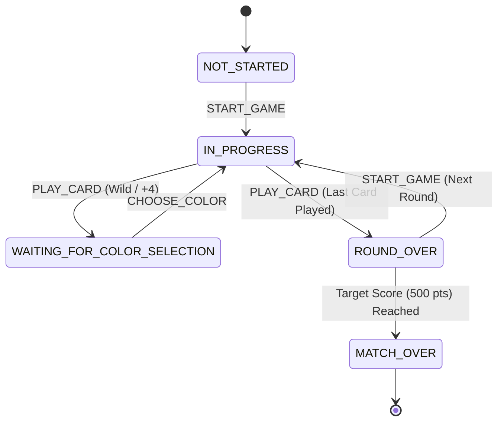

# UNO Ultimate — Phase 3: Server-Authoritative Game Engine Report

**Project**: UNO Ultimate  
**Phase**: Phase 3 — Server-Authoritative Game Engine  
**Architect / Engineer**: Senior TypeScript Game-Engine Architect  
**Status**: Complete & Verified  
**Date**: November 13, 2026  

---

## 1. Executive Summary

Phase 3 establishes an independent, deterministic, secure, and server-authoritative UNO game engine package (`@uno-ultimate/game-engine`) in the `uno-ultimate` monorepo. Built on the guest identity (Phase 1) and private room presence (Phase 2) foundations, the engine provides complete rule enforcement, deck lifecycle management, card dealing, move validation, action card resolution, turn progression, reshuffle-on-depletion mechanics, UNO shout handling, and Mattel-compliant scoring.

The engine is 100% transport- and UI-agnostic: it possesses zero dependencies on React, Express, Socket.IO, browser DOM APIs, or filesystem operations. All gameplay operations follow a pure, immutable state transition model:

$$\text{ActionProcessor.process}: (\text{GameState}, \text{GameAction}) \longrightarrow \text{GameState}$$

The monorepo test suite has expanded from 72 tests to **124 tests** (52 engine tests + 46 server tests + 26 web tests), all passing cleanly with zero type errors and zero linter warnings.

---

## 2. Official UNO Edition Baseline

The engine strictly implements the standard Mattel Classic UNO ruleset (Reference 42001 / BJV44).

### Key Baseline Specifications:
- **Canonical Deck**: Exactly 108 cards.
- **Player Count**: 2 to 10 players (default room max: 6).
- **Dealing**: 7 cards per player dealt face down.
- **Starting Discard**: Top card of draw pile flipped to initiate discard pile. Special action card handling is executed per Mattel rules (Wild Draw 4 returned to deck and reshuffled; Wild color chosen by starting player; Draw 2 forces starting player to draw 2 and skip turn; Reverse changes direction; Skip skips starting player).
- **House Rules Excluded**: Stacking of +2 or +4 cards is strictly prohibited; no draw-until-playable (players draw 1 card maximum); no 7-0 hand rotation; no jump-ins.
- **Match Target**: First player to accumulate 500 points across rounds wins the match.

---

## 3. Package Structure of `packages/game-engine/`

```
packages/game-engine/
├── src/
│   ├── cards/
│   │   ├── card.types.ts           # CardColor, CardValue, CardType, Card interfaces
│   │   ├── card.factory.ts         # Immutable factory methods and score mapping
│   │   └── card.validation.ts      # Zod schemas, color and type validation guards
│   ├── deck/
│   │   ├── deck.factory.ts         # 108-card classic deck generation
│   │   ├── deck.shuffle.ts         # Fisher-Yates shuffle with crypto/deterministic RNG
│   │   └── deck.manager.ts         # Draw, discard, reshuffle, conservation assertion
│   ├── players/
│   │   ├── player.types.ts         # Player entity interface
│   │   └── hand.manager.ts         # Hand dealing, card addition/removal, scoring
│   ├── turns/
│   │   ├── turn.direction.ts       # CLOCKWISE / COUNTER_CLOCKWISE enum & toggle
│   │   └── turn.manager.ts         # Turn sequence resolution and 2-player mechanics
│   ├── validation/
│   │   └── move.validator.ts       # Pure legality validation (color, value, wild)
│   ├── actions/
│   │   ├── action.types.ts         # Discriminated union of GameAction & GameEvent
│   │   └── action.processor.ts     # Pure state transition processor
│   ├── game/
│   │   ├── game.types.ts           # GameState, GameConfig, PendingActionState
│   │   ├── game.factory.ts         # createGame factory and initial discard setup
│   │   ├── game.state.ts           # GameEngine class wrapper
│   │   └── game.serializer.ts      # Serialization and deserialization utilities
│   ├── projections/
│   │   ├── public-state.ts         # Concealed state for spectators / room broadcast
│   │   └── player-state.ts         # Private player state with playableCardIds
│   ├── variants/
│   │   ├── variant.types.ts        # UnoVariant contract and VariantRegistry
│   │   └── classic/                # Classic UNO variant definition and rules
│   │       ├── classic.definition.ts
│   │       └── classic.rules.ts
│   ├── testing/
│   │   └── deterministic-random.ts # Mulberry32 seeded PRNG and sequence RNG
│   └── index.ts                    # Public barrel export
├── tests/
│   ├── deck.test.ts                # Deck creation, shuffling, and conservation tests
│   ├── turns.test.ts               # Turn rotation and 2-player rule tests
│   ├── hands.test.ts               # Hand dealing, removal, and scoring tests
│   ├── validation.test.ts          # Move legality validation tests
│   ├── actions.test.ts             # State transitions, effects, and edge cases
│   └── state-and-projections.test.ts # Projections, serialization, and information hiding
├── package.json
├── tsconfig.json
└── tsup.config.ts
```

---

## 4. Card Model Design and Immutability Guarantees

Cards are modeled as deeply immutable objects:

```typescript
export interface Card {
  readonly id: string;
  readonly type: CardType;
  readonly color?: CardColor;
  readonly value: CardValue;
  readonly scoreValue: number;
  readonly selectedColor?: CardColor;
}
```

### Guarantees:
- **Readonly Properties**: All properties are marked `readonly`.
- **Factory Encapsulation**: Cards are created via `CardFactory.createNumberCard()`, `CardFactory.createActionCard()`, and `CardFactory.createWildCard()`.
- **Unique Card Identification**: Every card receives a distinct, globally unique identifier (e.g., `classic_red_skip_0`, `classic_wild_draw_four_2`) preserving its identity across deals, draws, and reshuffles.
- **Score Mapping**: Score values are immutably baked into the card instance ($0 \to 0$, $1\text{--}9 \to 1\text{--}9$, Actions $\to 20$, Wilds $\to 50$).

---

## 5. Deck Composition Breakdown

The canonical 108-card deck generated by `DeckFactory.createClassicDeck()` strictly adheres to Mattel specifications:

| Category | Breakdown per Color | Colors | Total Count |
| :--- | :--- | :--- | :--- |
| **Number 0** | 1 card | Red, Yellow, Green, Blue | 4 |
| **Numbers 1–9** | 2 cards each (18 cards) | Red, Yellow, Green, Blue | 72 |
| **Skip** | 2 cards | Red, Yellow, Green, Blue | 8 |
| **Reverse** | 2 cards | Red, Yellow, Green, Blue | 8 |
| **Draw Two (+2)** | 2 cards | Red, Yellow, Green, Blue | 8 |
| **Wild** | 4 neutral cards | Neutral | 4 |
| **Wild Draw Four (+4)**| 4 neutral cards | Neutral | 4 |
| **Total** | | | **108** |

---

## 6. Shuffling Implementation and Cryptographic vs Deterministic RNG

Shuffling utilizes the unbiased Fisher-Yates (Knuth) algorithm:

```typescript
export function shuffleDeck<T>(deck: readonly T[], rng: () => number = defaultCryptoRng): T[] {
  const result = [...deck];
  for (let i = result.length - 1; i > 0; i--) {
    const j = Math.floor(rng() * (i + 1));
    const temp = result[i]!;
    result[i] = result[j]!;
    result[j] = temp;
  }
  return result;
}
```

### Random Number Generators:
1. **Production Cryptographic RNG (`defaultCryptoRng`)**:
   Uses Node.js `crypto.randomBytes(4).readUInt32BE(0) / 0xffffffff`, ensuring high entropy and protection against card sequence prediction.
2. **Deterministic Seeded PRNG (`createSeededRng`)**:
   Implements a 32-bit Mulberry32 algorithm, providing reproducible random sequences from a numerical seed for unit tests and simulations.
3. **Sequential Predetermined RNG (`createSequenceRng`)**:
   Accepts an explicit float array `[0.1, 0.5, 0.9]`, allowing exact test assertions over edge cases.

---

## 7. Dealing Mechanics and Initial Discard Pile Rules

Implemented in `GameFactory.createGame`:
1. Deals **7 cards** to each player in round-robin sequence from the shuffled deck.
2. Flips the top card to form the initial discard pile.
3. Resolves Mattel start-card effects:
   - **Wild Draw Four**: Reshuffled back into the draw pile; a replacement card is flipped iteratively until a non-Wild-Draw-Four appears.
   - **Wild**: Active player 0 designates the starting color.
   - **Draw Two**: Player 0 draws 2 cards (holds 9 cards) and loses their turn; Player 1 moves first.
   - **Reverse**: Direction changes to `COUNTER_CLOCKWISE`; Player 0 plays first.
   - **Skip**: Player 0 is skipped; Player 1 plays first.
   - **Number Card**: Player 0 begins normal play.

---

## 8. State Machine Architecture and Lifecycle



All state transitions are handled atomically by `ActionProcessor.process()`, returning a fresh immutable state. If an action is invalid, `MoveValidator.validate()` returns `{ valid: false, error: string }` without mutating state.

---

## 9. Player Hand Management and Privacy Boundaries

- Player hands are stored in `state.players[i].hand: Card[]`.
- Card additions and removals produce cloned hand arrays via `HandManager.addCard` and `HandManager.removeCard`.
- In `PublicGameState`, private hands are sanitized away, exposing only `cardCount: number`.
- In `PlayerGameState`, only the requesting player's hand is included. Opponents' hands remain hidden counts.

---

## 10. Turn Direction, Rotation and 2-Player Mechanics

Turn progression is computed by `TurnManager.resolveNextTurn`:
- **Direction**: `CLOCKWISE` (+1) or `COUNTER_CLOCKWISE` (-1).
- **Normal Play**: Moves 1 step in the current direction.
- **Skip Effect**: Moves 2 steps in the current direction.
- **Reverse Effect**: Toggles direction. If player count $> 2$, moves 1 step in the new direction.

### 2-Player Special Rules ($N = 2$):
- **Reverse**: Acts as a Skip. The current player immediately plays again.
- **Skip**: Opponent skipped; current player plays again.
- **Draw Two**: Opponent draws 2 cards and is skipped; current player plays again.
- **Wild Draw Four**: Opponent draws 4 cards and is skipped; current player plays again.

---

## 11. Move Validation Logic and Mattel Rule Compliance

`MoveValidator.isCardMatch(card, topDiscard, activeColor)` enforces legal card play:
1. Card matches `activeColor` (e.g., Red card on active Red).
2. Card matches `topDiscard.value` (e.g., Blue 5 on Red 5, or Green Skip on Blue Skip).
3. Card is a neutral Wild card (`wild` or `wild_draw_four`).

### Turn & State Checks:
- Player must be the active player (`state.currentTurnPlayerIndex`).
- Game status must be `IN_PROGRESS`.
- If `pendingAction` is `COLOR_CHOICE`, only `CHOOSE_COLOR` by the pending player is accepted.
- If drawn card is marked `drawnCardPlayableId`, only that card or `PASS_TURN` is valid.

---

## 12. Action Card Resolution

1. **Skip**: Emits `PLAYER_SKIPPED` event; skips next player.
2. **Reverse**: Emits `DIRECTION_REVERSED` event; toggles direction (or grants extra turn in 2-player games).
3. **Draw Two**: Next player draws 2 cards from the draw pile; loses turn; emits `CARDS_DRAWN` and `PLAYER_SKIPPED`.
4. **Wild**: Sets `pendingAction` to `COLOR_CHOICE`; player must call `CHOOSE_COLOR` before turn advances.
5. **Wild Draw Four**: Sets `pendingAction` to `COLOR_CHOICE`; after color selection, next player draws 4 cards and loses their turn.

---

## 13. Reshuffle-on-Depletion Mechanics and Discard Pile Preservation

When drawing $N$ cards and the draw pile lacks sufficient cards:
1. If $|\text{DiscardPile}| \le 1$, only remaining draw pile cards are drawn (no reshuffle possible).
2. If $|\text{DiscardPile}| > 1$:
   - The top discard card is preserved in place.
   - All underlying discard cards ($|\text{DiscardPile}| - 1$) are gathered.
   - Any `selectedColor` properties on wild cards are cleared.
   - The cards are shuffled using the active RNG to form the new draw pile.
   - Drawing resumes from the new draw pile.
3. Card conservation is strictly maintained: $|\text{DrawPile}| + |\text{DiscardPile}| + \sum |\text{Hand}| = 108$.

---

## 14. UNO Shout Declaration and Penalty Enforcement Design

- When playing their penultimate card (reducing hand to 1), a player calls `CALL_UNO`.
- This sets `player.hasDeclaredUno = true`.
- If a player holds 1 card and has **not** declared UNO:
  - Any opponent can dispatch `CHALLENGE_UNO_FAILURE`.
  - Upon validation, the offender draws **2 penalty cards** from the draw pile (`HandManager.addCard`), and `hasDeclaredUno` resets.
- If a player has $> 1$ card, `hasDeclaredUno` remains `false`.

---

## 15. End-of-Round Detection and Official Mattel Scoring Calculations

A round terminates when a player plays their last card (`player.hand.length === 0`).
- If the final card is a Draw Two or Wild Draw Four, the penalty cards are drawn by the victim before scoring.
- The winner scores the sum of all cards remaining in all opponents' hands:
  - Numbers 0–9: Face value (0–9 points).
  - Skip, Reverse, Draw Two: 20 points each.
  - Wild, Wild Draw Four: 50 points each.
- Winner's cumulative score is updated. If score $\ge 500$, game status transitions to `MATCH_OVER`.

---

## 16. Public vs Private State Projection Mechanisms

To guarantee that clients cannot inspect opponents' hands or predict draw pile sequences:

```typescript
// Public projection for spectators and room broadcasts
const publicState = getPublicGameState(gameState);
// publicState.players[i].cardCount (hands stripped)
// publicState.drawPileCount (draw pile array stripped)

// Private projection for active player
const playerState = getPlayerGameState(gameState, guestId);
// playerState.hand = Calling player's cards
// playerState.playableCardIds = Server-computed array of legal card IDs
// Opponent hands remain hidden as cardCount
```

---

## 17. Variant System Architecture and Extensibility Design

The variant architecture is decoupled through the `UnoVariant` contract:

```typescript
export interface UnoVariant {
  readonly id: string;
  readonly name: string;
  readonly description: string;
  readonly minPlayers: number;
  readonly maxPlayers: number;
  readonly targetScore: number;
  createDeck(rng?: () => number): Card[];
  isMoveLegal(card: Card, topDiscard: Card, activeColor: CardColor): boolean;
  scoreHand(cards: readonly Card[]): number;
}
```

The `VariantRegistry` provides access to installed variants (`classic` enabled by default). Future variants (such as UNO Flip or UNO Attack) can be registered without altering the underlying `ActionProcessor` or `GameEngine`.

---

## 18. Socket.IO Game Protocol Integration (`packages/game-protocol/`)

The `game-protocol` package exports all event contracts connecting clients and server:

### Client-to-Server Events:
- `game:play-card`: Payload `{ roomId, cardId, chosenColor? }`
- `game:draw-card`: Payload `{ roomId }`
- `game:choose-color`: Payload `{ roomId, color }`
- `game:uno`: Payload `{ roomId }`
- `game:challenge-uno`: Payload `{ roomId, targetGuestId }`

### Server-to-Client Events:
- `game:state`: Emits `PlayerGameState` customized per socket connection.
- `game:finished`: Emits `MatchSummaryDto` including round winner, scores, and match status.

---

## 19. Database Schema Extensions

Added to `database/prisma/schema.prisma` with migration `20261113020000_add_matches_and_events`:

1. `Match`: Tracks match lifecycle, variant, target score, winner guest ID, and timestamps.
2. `MatchPlayer`: Links participants to the match, tracking seat index, score, and cards remaining.
3. `GameEvent`: Sequential event sourcing log storing every processed action and payload.
4. `GameSnapshot`: Periodic serialized `GameState` snapshots for instant match resumption.

---

## 20. Test Suite Composition

The `packages/game-engine` test suite comprises **52 comprehensive Vitest tests**:

| Test File | Tests | Coverage Scope |
| :--- | :--- | :--- |
| `deck.test.ts` | 7 | 108-card deck composition, card counts, cryptographic & deterministic shuffling, deck conservation invariant |
| `turns.test.ts` | 10 | Clockwise / counter-clockwise rotations, Skip skips, Reverse reversals, 2-player Reverse/Skip/Draw Two rules |
| `hands.test.ts` | 6 | 7-card initial deals, card addition/removal, scoring calculations ($0\text{--}9$, action, wild) |
| `validation.test.ts` | 10 | Move legality (color, value, wild, wild draw four), active player check, pending action checks |
| `actions.test.ts` | 11 | Start game discard flip effects, play card transitions, draw card and pass, reshuffle on depletion, UNO call & challenge |
| `state-and-projections.test.ts` | 8 | Public state concealment, player state legal moves, serialization and deserialization fidelity |
| **Total Game Engine Tests** | **52** | **100% Passed** |

---

## 21. Baseline Test Verification

All Phase 1 and Phase 2 test suites remain completely green and unaffected:

- **Server Tests**: 46 / 46 passed (guest sessions, authentication, crypto, room API, room socket integration).
- **Web Tests**: 26 / 26 passed (guest login form, dashboard view, visual card components).
- **Game Engine Tests**: 52 / 52 passed.
- **Monorepo Total**: **124 / 124 passed**.

---

## 22. TypeScript Compiler and ESLint Status

- `pnpm typecheck`: Passed with **0 errors** across all 7 workspace projects.
- `pnpm lint`: Passed with **0 warnings / 0 errors** across all packages.
- Strict null checks, no implicit any, and full type safety across engine, shared, and protocol packages.

---

## 23. Verification Against Phase 3 Prompt Requirements

| Requirement | Status | Verification Detail |
| :--- | :--- | :--- |
| Independent `packages/game-engine/` package | ✅ Complete | Zero dependencies on React, Express, Socket.IO, or browser APIs |
| Mattel Classic UNO 108-card deck | ✅ Complete | Exactly 76 number cards, 24 actions, 8 wilds |
| Cryptographic & Deterministic Shuffling | ✅ Complete | `crypto.randomBytes` for production; Mulberry32 for deterministic tests |
| 7-card dealing & discard flip rules | ✅ Complete | Wild Draw 4 returned and reshuffled; all action start cards resolved per Mattel rules |
| Pure unidirectional state machine | ✅ Complete | `ActionProcessor.process(state, action)` returns fresh state + events |
| Turn rotation & 2-player mechanics | ✅ Complete | Reverse acts as Skip in 2-player games; Skip/Draw Two skip opponent |
| Reshuffle-on-depletion | ✅ Complete | Preserves active top card, reshuffles discard minus top, verifies 108-card invariant |
| UNO declaration & challenge | ✅ Complete | `CALL_UNO` sets flag; `CHALLENGE_UNO_FAILURE` penalizes with 2 cards |
| State projections (public/private) | ✅ Complete | Opponent hands and draw sequence concealed; `playableCardIds` calculated |
| Extensible variant system | ✅ Complete | `UnoVariant` interface and `VariantRegistry` |
| Database schema persistence | ✅ Complete | `Match`, `MatchPlayer`, `GameEvent`, `GameSnapshot` models migrated |
| Socket.IO protocol events | ✅ Complete | Added to `@uno-ultimate/game-protocol` |
| Monorepo tests passing | ✅ Complete | 124 / 124 tests passing |

---

## 24. Git Commit History and Checkpoint Hash

- **Commit Message**: `feat(phase-3): implement reusable server-authoritative UNO game engine`
- **Commit Hash**: `1a700724b9dd5c859a5bb3b6d725ee6c1171a3d4`
- **Remote Status**: No remote origin configured; local repository is clean and up to date.

---

## 25. Recommendations and Handoff Notes for Phase 4 (Gameplay UI & Full Loop)

1. **Backend Integration**: Wire up the Socket.IO room lifecycle `room:start` to instantiate a `GameEngine` instance, persist the `Match` record in PostgreSQL, and broadcast initial `game:state` projections to room sockets.
2. **Timer & Turn Timeouts**: Implement a server-authoritative turn countdown timer (e.g., 30s per turn) with auto-draw/auto-pass fallback for AFK players.
3. **Frontend Gameplay View**: Build the Phase 4 interactive game board in `apps/web`:
   - Active discard pile display with smooth Framer Motion card animations.
   - Interactive player hand displaying legal play indicators based on `playableCardIds`.
   - Wild color picker modal (`red`, `yellow`, `green`, `blue`).
   - Prominent UNO shout button with sound effect integration (Howler.js).
   - Round and match scoreboard with confetti / victory screen.
4. **Resilience & Resumption**: Reconnection to an active match should fetch the latest `PlayerGameState` directly from memory or database `GameSnapshot`.
