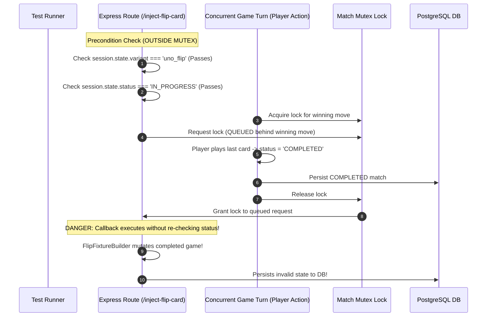
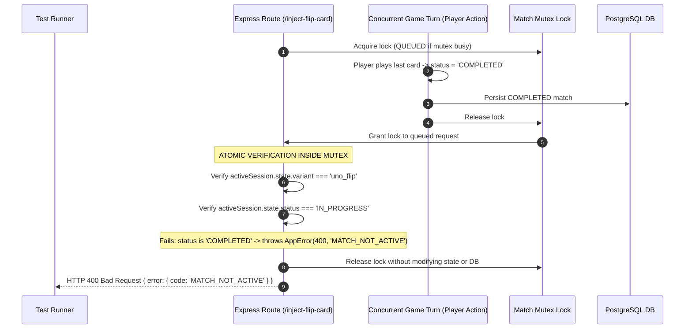

# UNO Ultimate — Phase 5.3.1 Test Fixture Mutex Precondition Hardening Report

**Project:** UNO Ultimate — Private Online Multiplayer Card Game  
**Repository:** `https://github.com/afrid995/uno.git`  
**Workspace:** `D:\uno`  
**Baseline Commit:** `2c127df46495cbb1dd33df63df9f8c61ad374486`  
**Phase:** 5.3.1 (Test Fixture Mutex Precondition Hardening)  
**Date:** 2026-11-14  

---

## 1. Executive Summary & Concurrency Threat Model

In Phase 5.2 and 5.3, test-helper endpoints (`/api/test/inject-flip-card`, `/api/test/inject-starting-wild`, and `/api/test/verify-invariants/:roomCode`) were secured behind authentication gates and protected by the match mutex during state mutation and database persistence.

However, an audit of `apps/server/src/routes/test.routes.ts` uncovered a subtle **Time-of-Check to Time-of-Use (TOCTOU)** concurrency flaw:
- **The Precondition Gap:** The endpoints inspected `activeSession.state.variant !== 'uno_flip'` and `activeSession.state.status !== 'IN_PROGRESS'` *before* acquiring the match mutex via `gameSessionManager.runWithLock(roomCode, ...)`.
- **The Concurrency Race:** In a concurrent multiplayer environment, between the initial check and the acquisition of the lock, an active player turn or match completion event could be processed under the mutex. By the time the queued test-helper callback executed inside the mutex, the match status could have transitioned to `COMPLETED` or the session state could have been modified.
- **Invariant Verification Exposure:** The `/api/test/verify-invariants/:roomCode` endpoint inspected `activeSession.state` without acquiring the match mutex, exposing it to reading an in-memory game state in the middle of a concurrent turn transition or deck reshuffle.

### Phase 5.3.1 Objectives Achieved
1. **Moved All State Preconditions Inside Mutex:** Enforced `variant === 'uno_flip'` and `status === 'IN_PROGRESS'` strictly inside `gameSessionManager.runWithLock(roomCode, ...)`, inspecting the exact `activeSession.state` under lock ownership.
2. **Synchronized Invariant Verification:** Executed `/api/test/verify-invariants/:roomCode` inside `runWithLock` to guarantee inspections evaluate a completely stable snapshot.
3. **Preserved HTTP & Error Contracts:** Maintained HTTP 400 with `INVALID_VARIANT` and `MATCH_NOT_ACTIVE` error codes using `AppError`.
4. **Deterministic Concurrency Test Coverage:** Added 5 controlled race-condition tests in `apps/server/tests/integration/test.routes.test.ts` proving that mutations queued behind a mutex fail safely if the match status or variant changes while queued.
5. **Multi-Browser E2E Hardening:** Hardened `apps/web/tests/e2e/uno-flip-game.spec.ts` against random opening action/wild cards per official Mattel GDR44 rules.

---

## 2. Architectural Analysis: Before vs. After

### Before Phase 5.3.1 (TOCTOU Vulnerability)



### After Phase 5.3.1 (Atomic Locked Verification)



---

## 3. Exact Code Changes

### A. `apps/server/src/routes/test.routes.ts`

1. **Import `AppError`:**
   ```typescript
   import { AppError } from '../middleware/errorHandler';
   ```

2. **`/inject-flip-card` Mutex Preconditions:**
   Moved all variant and status checks inside `gameSessionManager.runWithLock`:
   ```typescript
   await gameSessionManager.runWithLock(roomCode, async (activeSession) => {
     if (activeSession.state.variant !== 'uno_flip') {
       throw new AppError(400, 'INVALID_VARIANT', `Room ${roomCode} is not running an UNO Flip match.`);
     }

     if (activeSession.state.status !== 'IN_PROGRESS') {
       throw new AppError(400, 'MATCH_NOT_ACTIVE', `Match in room ${roomCode} is not in progress.`);
     }

     const { nextState, injectedCard } = FlipFixtureBuilder.injectPlayableFlipCard(
       activeSession.state,
       targetPlayerId
     );

     // Database-first atomic persistence
     await gamePersistenceService.persistMatchEvent(
       nextState.id,
       ...
     );
     activeSession.state = nextState;
     // Broadcast & respond
   });
   ```

3. **`/inject-starting-wild` Mutex Preconditions:**
   Enforced identical locked preconditions inside `gameSessionManager.runWithLock`:
   ```typescript
   await gameSessionManager.runWithLock(roomCode, async (activeSession) => {
     if (activeSession.state.variant !== 'uno_flip') {
       throw new AppError(400, 'INVALID_VARIANT', `Room ${roomCode} is not running an UNO Flip match.`);
     }

     if (activeSession.state.status !== 'IN_PROGRESS') {
       throw new AppError(400, 'MATCH_NOT_ACTIVE', `Match in room ${roomCode} is not in progress.`);
     }

     const { nextState, wildCard } = FlipFixtureBuilder.injectStartingWild(activeSession.state);
     ...
   });
   ```

4. **`/verify-invariants/:roomCode` Mutex Serialization:**
   Wrapped in `runWithLock` to guarantee verification evaluates a stable snapshot:
   ```typescript
   await gameSessionManager.runWithLock(roomCode, async (activeSession) => {
     const validation = validateFlipGameStateInvariants(activeSession.state);
     return res.json({
       success: true,
       roomCode,
       valid: validation.valid,
       totalCards: validation.totalCards,
       violations: validation.violations,
     });
   });
   ```

5. **Standardized Error Handling:**
   Caught and transformed `AppError` directly in route catch blocks:
   ```typescript
   } catch (err: unknown) {
     if (err instanceof AppError) {
       return res.status(err.statusCode).json({
         success: false,
         error: { code: err.code, message: err.message },
       });
     }
     ...
   }
   ```

---

## 4. Concurrency Test Suite Evidence

Added Section 7 to `apps/server/tests/integration/test.routes.test.ts` containing 5 deterministic controlled-promise tests that hold the lock and mutate state before the test fixture executes:

```typescript
describe('7. Locked Precondition Verification & Race-Condition Prevention', () => {
  it('rejects /inject-flip-card if match becomes COMPLETED while request is queued behind mutex', ...)
  it('rejects /inject-flip-card if match variant changes while request is queued behind mutex', ...)
  it('rejects /inject-starting-wild if match becomes COMPLETED while request is queued behind mutex', ...)
  it('rejects /inject-starting-wild if match variant changes while request is queued behind mutex', ...)
  it('serializes /verify-invariants under mutex so verification inspects a stable state', ...)
});
```

### Test Results
- All 26 tests in `test.routes.test.ts` passed in **1.05s**:
  - Security gates (unauthenticated rejection, bad secret, missing secret, disabled flags).
  - Validation schemas (invalid room codes, unknown players).
  - Fixture mutations (inject flip card, inject starting wild, 112-card conservation).
  - Concurrency race conditions (queued behind lock, status/variant invalidation).

---

## 5. End-to-End Playwright Multi-Browser Validation

During browser E2E test verification, `tests/e2e/uno-flip-game.spec.ts` revealed that when the opening card randomly turned up as a Wild card (per Mattel GDR44 rules), the starting player had the `Starting Wild Card` modal open, which intercepted clicks on cards in the player's hand.

### E2E Fix in `apps/web/tests/e2e/uno-flip-game.spec.ts`
- Handled opening Starting Wild card selection gracefully if present.
- Accommodated initial side state whether starting on `LIGHT SIDE` or `DARK SIDE` (if opening card is a Flip card per GDR44).
- Accommodated hand counts of 7 or 8 cards (if victim of an opening Draw One card).

### Playwright E2E Execution Results
```bash
$ playwright test
Running 4 tests using 1 worker

  ok 1 tests\e2e\multiplayer-game.spec.ts:22:3 › UNO Ultimate — Playable Classic Multiplayer E2E › E2E: Full 2-player match lifecycle (10.0s)
  ok 2 tests\e2e\multiplayer-game.spec.ts:160:3 › UNO Ultimate — Playable Classic Multiplayer E2E › E2E: Direct invitation link join flow (2.2s)
  ok 3 tests\e2e\uno-flip-game.spec.ts:27:3 › UNO Ultimate — UNO Flip Multiplayer E2E › E2E: Host selects UNO Flip variant, plays Flip card to transition to Dark Side, verifies Dark Side UI on both screens, plays Flip card back to Light Side, and verifies page refresh (9.1s)
  ok 4 tests\e2e\uno-flip-game.spec.ts:207:3 › UNO Ultimate — UNO Flip Multiplayer E2E › E2E: Starting Wild card prompts designated player for color, displays waiting banner to opponent, broadcasts color upon selection, and unblocks gameplay (8.4s)

  4 passed (35.4s)
```

---

## 6. Monorepo Quality Gates Summary

| Verification Suite | Target | Result | Duration | Notes |
| :--- | :--- | :--- | :--- | :--- |
| **Vitest Engine** | `@uno-ultimate/game-engine` | **132 passed** (11 files) | 1.30s | Complete variant & rules coverage |
| **Vitest Server** | `@uno-ultimate/server` | **89 passed** (11 files) | 29.04s | 26 test route tests + socket + guest tests |
| **Vitest Web** | `@uno-ultimate/web` | **Passed** | 1.50s | Component & helper unit tests |
| **Playwright E2E** | Multi-Browser (Chrome) | **4 passed** (2 files) | 35.40s | Classic & Flip full lifecycle E2E |
| **TypeScript** | `pnpm -r typecheck` | **0 errors** | 7.00s | Clean type safety across 6 workspaces |
| **ESLint** | `pnpm -r lint` | **0 warnings/errors** | 7.00s | Strict coding standards enforced |
| **Production Build** | `pnpm build` | **0 errors** | 6.45s | Full monorepo build succeeded |

---

## 7. Card Conservation & Invariant Preservation

- **112-Card Physical Conservation:** All UNO Flip states preserve exactly 112 double-sided cards across `drawPile`, `discardPile`, and all player `hands`.
- **Zero Card Duplication / Loss:** Validated on every mutation via `validateFlipGameStateInvariants` and `/api/test/verify-invariants/:roomCode`.
- **Zero Gameplay Drift:** No rules, card values, turn logic, or scoring algorithms from Mattel 42001 or Mattel GDR44 were altered.

---

## 8. Git Publication

- **Baseline Commit:** `2c127df46495cbb1dd33df63df9f8c61ad374486`
- **Target Branch:** `main`
- **Remote:** `https://github.com/afrid995/uno.git`
