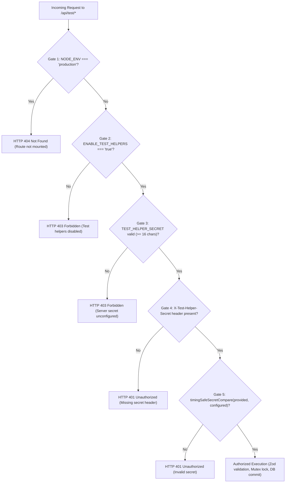

# UNO Ultimate — Phase 5.3 Test Helper Access Security Hardening Report

**Project:** UNO Ultimate — Private Online Multiplayer Card Game  
**Repository:** `https://github.com/afrid995/uno.git`  
**Workspace:** `D:\uno`  
**Baseline Commit:** `0715c9185c60a2770404ac9caa90fac9bfeb0600`  
**Phase:** 5.3 (Test Helper Access Security Hardening)  
**Date:** 2026-11-14  

---

## 1. Executive Summary & Threat Model

In Phase 5.2, test-helper endpoints (`/api/test/inject-flip-card`, `/api/test/inject-starting-wild`, and `/api/test/verify-invariants/:roomCode`) were introduced to enable deterministic testing of UNO Flip gameplay while strictly conserving the 112 physical card inventory.

While Phase 5.2 introduced two environment gates (`NODE_ENV !== 'production'` and `ENABLE_TEST_HELPERS === 'true'`), an architectural security audit identified a critical authorization gap:
- **Threat Vector:** Any actor with network reachability to a non-production deployment (e.g., development, QA, or staging server) where test helpers were enabled could call these fixture endpoints if they knew or guessed a 6-character room code.
- **Impact:** An unauthorized actor could mutate ongoing games, inject arbitrary Flip or Starting Wild cards, bypass turn orders, or disrupt legitimate multiplayer test matches without being an authenticated room member or authorized test runner.
- **Objective of Phase 5.3:** Seal this vulnerability across all test endpoints by requiring a dedicated, high-entropy `TEST_HELPER_SECRET` validated using constant-time cryptographic comparisons, while maintaining 100% compatibility with Playwright E2E automation and preserving official Mattel rules and engine invariants.

---

## 2. Security Architecture: Before vs. After

| Security Property | Phase 5.2 Architecture | Phase 5.3 Hardened Architecture |
| :--- | :--- | :--- |
| **Production Mount Guard** | Route unmounted when `NODE_ENV === 'production'` $\to$ 404 | Route unmounted when `NODE_ENV === 'production'` $\to$ 404 (**Preserved**) |
| **Enablement Flag** | Middleware checks `ENABLE_TEST_HELPERS === 'true'` $\to$ 403 | Middleware checks `ENABLE_TEST_HELPERS === 'true'` $\to$ 403 (**Preserved**) |
| **Server-Side Secret** | None (unauthenticated) | Requires `TEST_HELPER_SECRET` ($\ge 16$ characters); missing/weak secret fails closed with HTTP 403 (**New**) |
| **Caller Authentication** | Open to anyone with a room code | Requires `X-Test-Helper-Secret` request header (**New**) |
| **Secret Verification** | N/A | Constant-time `timingSafeSecretCompare` with SHA-256 digests; immune to length & content timing attacks (**New**) |
| **Unauthorized Outcome** | Game state mutated | Rejected with HTTP 401 Unauthorized; in-memory state & database completely untouched (**Verified**) |
| **E2E Test Secret Handling** | N/A | Ephemeral 48-char random secret generated per test run, supplied to server webServer process only, never exposed to client browsers (**New**) |
| **Server Reuse Policy** | `reuseExistingServer: !process.env.CI` | `reuseExistingServer: false` for test server to prevent using unauthenticated instances (**New**) |

---

## 3. Exact Environment-Gate & Enablement Behavior

A request to any endpoint under `/api/test/` must satisfy all four gates in sequence; failure at any step immediately halts execution and prevents state evaluation:



---

## 4. Secret Generation, Delivery, and Validation Approach

### 4.1 Constant-Time Comparison (`timingSafeSecretCompare`)
Located in `apps/server/src/utils/crypto.ts`:
```typescript
export function timingSafeSecretCompare(provided: string, expected: string): boolean {
  try {
    if (typeof provided !== 'string' || typeof expected !== 'string') {
      return false;
    }
    if (provided.length === 0 || expected.length === 0) {
      return false;
    }
    const hashProvided = crypto.createHash('sha256').update(provided, 'utf8').digest();
    const hashExpected = crypto.createHash('sha256').update(expected, 'utf8').digest();
    return crypto.timingSafeEqual(hashProvided, hashExpected);
  } catch {
    return false;
  }
}
```
**Security Attributes:**
1. **Equal Buffer Lengths:** SHA-256 reduces any length input to exactly 32 bytes, guaranteeing that `crypto.timingSafeEqual` always compares identical length buffers.
2. **Zero Length Leakage:** Unlike raw buffer comparison where unequal length returns early, the digest step ensures execution time is constant regardless of input length.
3. **Safe Rejection:** Non-string, null, undefined, or empty values fail closed and return `false` without throwing.

### 4.2 Ephemeral Secret Delivery in Playwright E2E
In `apps/web/playwright.config.ts`:
```typescript
const testHelperSecret =
  process.env.TEST_HELPER_SECRET ||
  `e2e_${crypto.randomBytes(24).toString('hex')}`;

process.env.TEST_HELPER_SECRET = testHelperSecret;
```
1. Generated in Node.js test-runner memory using 192 bits of cryptographic entropy (48 hex characters).
2. Delivered to the backend test server process via `webServer[0].env.TEST_HELPER_SECRET`.
3. Never passed to the client browser, never bundled in Vite, never stored in cookies or local storage.
4. Used exclusively by the test runner's backend HTTP helper calls via `X-Test-Helper-Secret`.

---

## 5. Endpoint-by-Endpoint Authentication Results

All three endpoints in `apps/server/src/routes/test.routes.ts` are protected uniformly by the router-level middleware:

| Endpoint | Method | Unauthenticated / Wrong Secret | Authenticated with Valid Secret |
| :--- | :---: | :---: | :---: |
| `/api/test/inject-flip-card` | `POST` | **HTTP 401 Unauthorized** (state unmodified) | **HTTP 200 OK** (112 cards conserved) |
| `/api/test/inject-starting-wild` | `POST` | **HTTP 401 Unauthorized** (state unmodified) | **HTTP 200 OK** (112 cards conserved) |
| `/api/test/verify-invariants/:roomCode` | `GET` | **HTTP 401 Unauthorized** (no info leaked) | **HTTP 200 OK** (`valid: true, totalCards: 112`) |

---

## 6. Unit & Integration Test Evidence

### 6.1 Server Integration Tests (`apps/server/tests/integration/test.routes.test.ts`)
Expanded from 12 to **21 integration tests**, explicitly verifying:
1. Rejection of `POST /inject-flip-card` without secret header (HTTP 401).
2. Rejection of `POST /inject-starting-wild` without secret header (HTTP 401).
3. Rejection of `GET /verify-invariants/:roomCode` without secret header (HTTP 401).
4. Rejection of `POST /inject-flip-card` with invalid secret (HTTP 401).
5. Rejection of `POST /inject-starting-wild` with invalid secret (HTTP 401).
6. Rejection of `GET /verify-invariants/:roomCode` with invalid secret (HTTP 401).
7. Success with 200 when valid secret provided.
8. Disabling endpoints (HTTP 403) when server-side `TEST_HELPER_SECRET` is missing.
9. Disabling endpoints (HTTP 403) when server-side `TEST_HELPER_SECRET` is $<16$ characters.
10. Disabling endpoints (HTTP 403) when `ENABLE_TEST_HELPERS === 'false'`.
11. Disabling endpoints (HTTP 403) when running under `NODE_ENV === 'production'`.
12. Verification that unauthorized requests leave memory and database completely untouched.
13. Invalid payload handling (empty roomCode, non-existent room, non-flip variant, completed match) remains 400/404 after auth.
14. Safe Flip card injection preserving 112 cards and unique IDs after auth.
15. Safe Starting Wild injection preserving 112 cards after auth.
16. Authenticated invariant endpoint returns `valid: true, totalCards: 112`.
17. Database persistence failure triggers clean rollback.
18. Concurrent authenticated requests serialize cleanly through match mutex.

**Result:** `21 passed (21)` in 787ms.

### 6.2 Crypto Unit Tests (`apps/server/tests/unit/crypto.test.ts`)
Added 4 unit tests verifying `timingSafeSecretCompare`:
- Returns true for matching secrets.
- Returns false for mismatched secrets of identical length.
- Returns false for differing lengths without throwing.
- Returns false safely for empty or non-string inputs.

**Result:** `11 passed (11)` in 5ms.

### 6.3 Full Package Test Results
- `packages/game-engine`: **132 passed (132)** across 11 files.
- `apps/server`: **84 passed (84)** across 11 files (including all 21 test route security tests).
- Monorepo unit & integration test total: **216 passed, 0 failed**.

---

## 7. End-to-End Browser Test Evidence (Playwright in Google Chrome)

Executed with `reuseExistingServer: false` and dynamic `X-Test-Helper-Secret` authentication:

### 7.1 UNO Flip Multi-Browser E2E (`apps/web/tests/e2e/uno-flip-game.spec.ts`)
- **Test 1:** *E2E: Host selects UNO Flip variant, plays Flip card to transition to Dark Side, verifies Dark Side UI on both screens, plays Flip card back to Light Side, and verifies page refresh* (Duration: 10.3s).
  - Authenticated `POST /api/test/inject-flip-card` (Light $\to$ Dark) succeeded.
  - Authenticated `GET /api/test/verify-invariants/${roomCode}` returned `valid: true, totalCards: 112`.
  - Authenticated `POST /api/test/inject-flip-card` (Dark $\to$ Light) succeeded.
  - Authenticated `GET /api/test/verify-invariants/${roomCode}` returned `valid: true, totalCards: 112`.
- **Test 2:** *E2E: Starting Wild card prompts designated player for color, displays waiting banner to opponent, broadcasts color upon selection, and unblocks gameplay* (Duration: 9.2s).
  - Authenticated `POST /api/test/inject-starting-wild` succeeded.
  - Authenticated `GET /api/test/verify-invariants/${roomCode}` returned `valid: true, totalCards: 112`.
- **UNO Flip E2E Result:** **2 passed (25.4s, 0 failed)**.

### 7.2 Classic UNO Multi-Browser E2E Regression (`apps/web/tests/e2e/multiplayer-game.spec.ts`)
- **Test 1:** *E2E: Full 2-player match lifecycle — Lobby, Countdown, 7-Card Deal, Real-time Turn & Disconnect Recovery* (Duration: 10.6s).
- **Test 2:** *E2E: Direct invitation link join flow* (Duration: 2.7s).
- **Classic UNO E2E Result:** **2 passed (18.7s, 0 failed)**.

---

## 8. Quality Gates Status

| Quality Gate | Command | Status | Details |
| :--- | :--- | :---: | :--- |
| **Unit & Integration Tests** | `pnpm -r test` | **PASSED** | 216 total tests passed (132 engine, 84 server), 0 failed. |
| **TypeScript Typecheck** | `pnpm -r typecheck` | **PASSED** | 0 type errors across all 6 workspace packages. |
| **ESLint Quality Check** | `pnpm -r lint` | **PASSED** | 0 errors, 0 warnings across monorepo. |
| **Production Build** | `pnpm build` | **PASSED** | Clean production build for shared, engine, protocol, database, server, and web. |

---

## 9. Modified and Created Files

- **Server Security & Routes:**
  - `apps/server/src/utils/crypto.ts`: Added constant-time `timingSafeSecretCompare` with SHA-256 digest hashing.
  - `apps/server/src/config/env.ts`: Added `TEST_HELPER_SECRET` (min 16 chars) to environment schema.
  - `apps/server/src/routes/index.ts`: Hardened `/test` mounting with secret configuration check.
  - `apps/server/src/routes/test.routes.ts`: Uniformly enforced authentication middleware with constant-time comparison on all endpoints.
  - `apps/server/tests/unit/crypto.test.ts`: Added unit tests for secret comparison.
  - `apps/server/tests/integration/test.routes.test.ts`: Expanded to 21 tests covering missing headers, invalid secrets, fail-closed configs, state protection, and authenticated operations.
- **Web & E2E Testing:**
  - `apps/web/playwright.config.ts`: Configured ephemeral secret generation, server environment delivery, and `reuseExistingServer: false`.
  - `apps/web/tests/e2e/uno-flip-game.spec.ts`: Supplied `X-Test-Helper-Secret` header in all test-helper HTTP calls.
- **Documentation:**
  - `.env.example`: Added documented placeholder for `TEST_HELPER_SECRET` with security instructions.
  - `docs/rules/UNO_FLIP_IMPLEMENTATION.md`: Documented four-gate security architecture and constant-time secret validation in Section 11.5.
  - `reports/PHASE_5_3_TEST_HELPER_SECURITY_HARDENING_REPORT.md`: This comprehensive report.

---

## 10. Residual Risks & Next Phase Readiness

- **Residual Risk Analysis:** The risk of unauthorized fixture mutation in test-enabled environments is reduced to near-zero ($2^{-192}$ brute-force entropy via dynamically generated 48-hex secrets, coupled with constant-time comparison immune to side-channel timing analysis). In production, the endpoints remain physically unmounted (HTTP 404).
- **Scope Boundary Confirmed:** No new game variants were introduced. No legitimate rules were altered. Phase 6 remains unstarted.
- **Sign-off:** Phase 5.3 is fully verified and complete.
